<div align="center">


<p>
  <a href="https://github.com/Abdulrahman-kawas/lowi_smart_robot/actions/workflows/spider-robot.yml"></a>
  
  
  
  
  
</p>

[English](README.md) · **日本語**

[Lowi とは](#lowi-とは) ·
[全体のつながり](#全体のつながり) ·
[ロボットの中身](#ロボットの中身) ·
[Telegram と WhatsApp](#telegram-と-whatsapp) ·
[シミュレーター](#シミュレーター) ·
[クイックスタート](#クイックスタート) ·
[モバイルアプリ](#モバイルアプリ) ·
[ロードマップ](#進捗とロードマップ)

</div>

---

## Lowi とは

Lowi は、話しかけて操作する6本脚のスパイダーロボットです。アラビア語で「Lowi、前に進んで」と言えば歩き、
「見て」と言えば写真を撮って見えたものを説明します。難しい質問には「ちょっと待って」と答え、
ホームサーバーの大きなモデルで回答します。

- **自分で安全を守る。** 障害物の近く、傾いたとき、ブレインとの通信が途切れたときに自分で止まります。安全のためにネットワークを待つことはありません。
- **速さが必要なところは速く。** 「止まれ」や簡単な動作は、モデルを通さずロボット上で処理します。
- **待てる処理は賢く。** 画像認識や難しい質問はホームサーバーへ。クラウドはネット接続時だけ手伝います。
- **どこからでも操作。** Telegram、WhatsApp、Tailscale 経由のライブダッシュボード。モバイルアプリも開発予定です。

<!-- 写真スロット：docs/images/photos/robot-hero.jpg（正面・斜め前から）に差し替え -->
<p align="center"></p>

---

## 全体のつながり

<p align="center"></p>

| マシン | 動いているもの | そこに置く理由 |
|---|---|---|
| **ロボット**<br>Raspberry Pi 4・4 GB | コア0で50 Hzのボディループ（逆運動学・歩容・バランス）・LiDARとIMUの反射動作・コマンドゲートウェイ・MQTTブローカー・高速な音声処理（Whisper tiny、LFM2.5-350M、Piper） | ネットが一切なくても動き続ける必要がある |
| **ホームサーバー**<br>i7-8700・15 GB・GPUなし | ブレイン（プランナー・スキル・記憶・ダッシュボード）・Telegram と WhatsApp の Lowi・LFM2.5-VL-1.6B による画像認識・LFM2.5-1.2B による難しい質問・Whisper small | 1秒待てる重い処理 |
| **AWS**<br>Lightsail と EC2 | Lightsail はホームサーバーへの移行まで Lowi を動かし、移行後は予備として待機・3D マッピング（SLAM）用の EC2 ワーカーは仕事の時だけ起動し、自動で停止 | 短時間だけ必要な追加の計算力。時間課金で、ロボットの動作には不要 |
| **AIクラウド**<br>任意 | NVIDIA NIM 上の Kimi、Claude、Gemini | 高度な推論。ネット接続時のみ |
| **スマートフォン** | Telegram、WhatsApp、ダッシュボード、今後のアプリ | 遠隔操作は必ずブレインを経由する |
| **ノートPC** | シミュレーター、テスト、SSHでのデプロイ | ハードウェアに触れずに開発・テスト |

AWS の認証情報を持つのはホームサーバーだけで、できるのはマッピング用ワーカーの起動・停止・状態確認のみです。
Pi は AWS の認証情報を一切持ちません。

### 音声コマンドの流れ

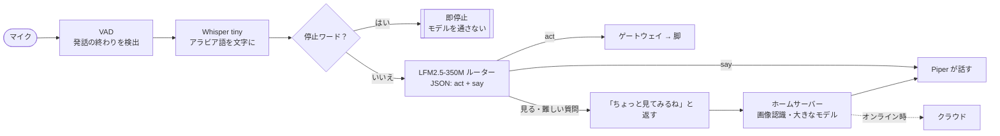

動作と発話は同時に行います。画像認識やクラウドからの回答は**話すだけ**で、ロボットを動かすことはありません。
カメラが命令のような文字を読み取っても、それで動かないようにするためです。

### ネットワークの状態で変わる回答者

| ネットワーク | 回答する人 | 状況 |
|---|---|---|
| インターネットとホームサーバーあり | Lowi（必要ならクラウドのモデルも使う） | ロボット → サーバーは稼働中（1〜2秒で回答）。Lowi への接続は次のステップ |
| ホームサーバーのみ（ネットなし） | サーバー上のローカルモデルで動くオフライン版 Lowi | 開発中 |
| ロボット単体 | 「今ネットがないけど、答えるね」と言い、Pi の小さなモデルで回答。会話はあとで Lowi に送る | 開発中 |

---

## ロボットの中身

<p align="center"></p>

<details>
<summary><b>パーツ一覧</b></summary>

| パーツ | 型番 | 役割 |
|---|---|---|
| コンピューター | Raspberry Pi 4・4 GB、Raspberry Pi OS Lite 64-bit | ボディループ、音声、ゲートウェイ、ブローカー |
| LiDAR | Unitree 4D LiDAR L2（IMU内蔵）、Ethernet接続 | 障害物・傾き・転倒の検知 |
| サーボボード | Lynxmotion SSC-32U、USB接続、115200 baud | 関節角度をサーボのパルスに変換 |
| サーボ | DSSERVO RDS3218（270°）× 18 | 脚6本 × 付け根・腿・すね |
| サーボ電源 | UBEC 6.0 V × 2 | 左脚用と右脚用 |
| カメラ | USB ウェブカメラ（Brave 7 LE） | 必要な時に撮影 |
| オーディオ | USB マイク、USB または 3.5 mm スピーカー | 音声の入出力 |
| ホームサーバー | Intel i7-8700、RAM 15 GB、GPUなし、Ubuntu 24.04 | ブレイン、画像認識、Lowi |

</details>

<!-- 写真スロット：docs/images/photos/robot-top.jpg、robot-lidar.jpg、robot-legs.jpg に差し替え -->
<table>
  <tr>
    <td width="33%"></td>
    <td width="33%"></td>
    <td width="33%"></td>
  </tr>
</table>

---

## Telegram と WhatsApp

<p align="center"></p>

| | Telegram | WhatsApp |
|---|---|---|
| **役割** | 操作：タスク、状態確認、写真、承認、非常停止 | Lowi との会話（1対1・グループ） |
| **送るもの** | 普通の文章、ボイスメモ、`/photo 机の上に何がある？` などのコマンド | メッセージとボイスメモ |
| **通知** | 障害物での停止、転倒、傾き、接続断、非常停止 | 短い通知（種類ごとに送信間隔を制限） |
| **応答する相手** | オーナーのアカウントのみ（`SB_TELEGRAM_OWNER_IDS`） | サブの WhatsApp 番号で動作 |

Lowi は、すべてのチャネル（音声、Telegram、WhatsApp、グループ）の会話を一言残らず記憶します。
写真は、頼まれたときだけ保存します。

> [!IMPORTANT]
> Telegram のアカウントはロボットの鍵です。2段階認証を必ず有効にしてください。

<details>
<summary><b>Telegram のコマンド一覧</b></summary>

```text
自由に書く・話す：質問、履歴書やメールの依頼、ロボットへの仕事
/run <task>            複数ステップのロボットタスク
/status  /scan         ロボットの状態と LiDAR の要約
/photo [質問]          カメラ写真（画像認識の回答付き）
/stand  /sit  /relax   姿勢
/stop  /estop  /release
/pause  /resume  /cancel
/record [秒]  /map <job id>
/memory [検索語]  /forget <id>
```

承認が必要な動作には、**承認**と**拒否**のボタンが付きます。

これらのコマンドはブレイン専用のボット（[`telegram.py`](spider-robot/brain/src/spider_brain/telegram.py)）に組み込まれています。
Lowi が Telegram を担当している間はブレインのボットを止めているので、ボットは常に1つだけです。

</details>

---

## シミュレーター

シミュレーターは**実機と同じボディのコード**を動かします。同じ `Robot` クラス、歩容、逆運動学、安全ルールに、
仮想サーボと LiDAR 付きの仮想の部屋を組み合わせています。危険な動作は、実機と同じように拒否されます。

<table>
  <tr>
    <td width="50%" align="center">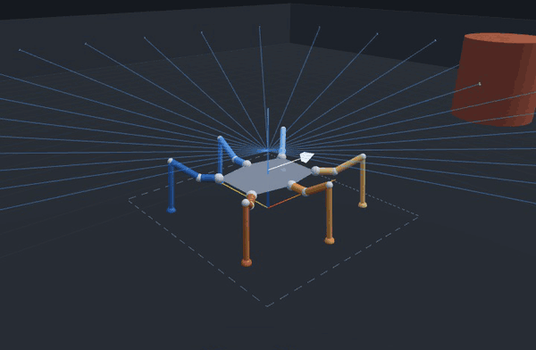<br><sub>シミュレーター：歩く → 曲がる → あいさつ</sub></td>
    <!-- 写真スロット：docs/images/photos/robot-walk.gif に差し替え -->
    <td width="50%" align="center"><br><sub>実機（近日公開）</sub></td>
  </tr>
</table>

```bash
cd spider-robot/body
uv sync
uv run spider-sim-view --config config/robot.sim.yaml
# http://127.0.0.1:8770 を開く
```

**キー操作：** <kbd>W</kbd> <kbd>S</kbd> 前進・後退 · <kbd>A</kbd> <kbd>D</kbd> 横移動 ·
<kbd>Q</kbd> <kbd>E</kbd> 旋回 · <kbd>Space</kbd> 停止 · <kbd>Esc</kbd> 非常停止。
パネルには姿勢、3種類の歩容、17種類のジェスチャーもあります。

<details>
<summary><b>コントロールパネルを見る</b></summary>

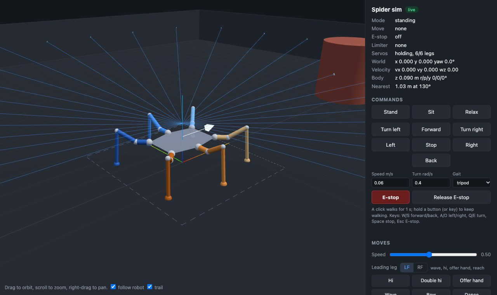

</details>

---

## クイックスタート

| やりたいこと | 必要なもの | 手順 |
|---|---|---|
| 歩く様子を見たい | ノートPC | [1. シミュレーター](#1-歩く様子を見る) |
| コードを確認したい | ノートPC | [2. テスト](#2-テストを実行) |
| 1台で全体を動かしたい | ノートPC と Mosquitto | [3. フルスタック](#3-1台のpcで全体を動かす) |
| 実機を作りたい | Pi 4、LiDAR、サーボ、ホームサーバー | [4](#4-ロボットのセットアップ) → [5](#5-ホームサーバーのセットアップ) → [6](#6-ロボットの更新) |

**必要なもの：** Python 3.11 以上、[uv](https://docs.astral.sh/uv/)、初回だけインターネット（3D表示が three.js を読み込みます）。

### 1. 歩く様子を見る

```bash
cd spider-robot/body && uv sync
uv run spider-sim-view --config config/robot.sim.yaml   # http://127.0.0.1:8770
```

### 2. テストを実行

```bash
cd spider-robot
for p in common body gateway voice brain; do (cd $p && uv sync --all-extras && uv run pytest -q); done
```

同じチェックが、push のたびに GitHub Actions で実行されます。`ruff`、シェルの構文チェック、
秘密情報のスキャン、LiDAR ブリッジのビルドも含みます。

### 3. 1台のPCで全体を動かす

ローカルのブローカー、仮想ハードウェアのボディ、手動で操作するブレインを起動します：

```bash
cd spider-robot
mosquitto -c infra/local/mosquitto-sim.conf &
(cd body && uv sync && uv run spider-body --config config/robot.sim.yaml --sim) &
cd brain && uv sync && uv run spider-brain teleop
```

### 4. ロボットのセットアップ

1. Raspberry Pi Imager で **Raspberry Pi OS Lite 64-bit** を書き込み、SSH と Wi-Fi を有効にします。ヒートシンクとファンを付けます。
2. Tailscale のネットワークに参加します：
   ```bash
   curl -fsSL https://tailscale.com/install.sh | sh && sudo tailscale up
   ```
3. `spider-robot/` フォルダを Pi にコピーしてインストールします。すべてをインストールしますが、**動くものは何も起動しません**：
   ```bash
   bash ~/spider-robot/infra/pi/setup_pi.sh
   ```
4. ノートPCで、ブローカーの Tailscale 用リスナーの証明書を作ります。CA の鍵はノートPCから外に出しません：
   ```bash
   cd spider-robot/infra/local
   BROKER_HOST=<pi-tailscale-name> BROKER_IP=<pi-tailscale-ip> bash make_local_certs.sh
   ```
   `ca.crt`、`server.crt`、`server.key` を Pi の `/etc/mosquitto/spider/` にコピーし、`mosquitto-tls.conf` を設置します。
5. `/etc/spider/robot.yaml` にサーボボードを設定します：`ls /dev/serial/by-id/` で表示されたパスを `ssc.port` に書きます。
6. カメラ、マイク、スピーカーをつないで確認します。写真を1枚撮り、4秒録音して再生します：
   ```bash
   bash ~/spider-robot/infra/pi/hw_check.sh
   ```
7. 初めての動作。**ロボットを台に載せ、脚を浮かせた状態で**行います：
   ```bash
   sudo -u spider /opt/spider/spider-robot/body/.venv/bin/spider-calibrate --config /etc/spider/robot.yaml check
   # 続けて同じコマンドで center、trim、direction
   sudo systemctl start spider-body
   spider-robotctl status
   spider-robotctl bench stand
   ```

> [!WARNING]
> キャリブレーションまではサーボの電源を切っておき、モーター電源のスイッチを手の届く所に置いてください。
> ハードウェアの非常停止（リレー、ウォッチドッグ、ヒューズ）のテストに合格するまで、床の上では歩かせないでください。

### 5. ホームサーバーのセットアップ

Ubuntu 24.04 で、同じ Tailscale のネットワークに参加した状態で実行します：

```bash
cd spider-robot
bash infra/server/setup_server.sh            # llama-server のビルド、ブレインとモデルのインストール
# 普段使いのデスクトップでは：START_MODELS=0 BUILD_JOBS=4 bash infra/server/setup_server.sh
```

次に、ブレインの証明書を `/etc/spider-brain/certs/` に、設定を `/etc/spider-brain/brain.env` に、
秘密情報（ボットのトークン、APIキー）を `/etc/spider-brain/secrets.env` に置いてから起動します：

```bash
sudo systemctl enable --now spider-brain
```

ダッシュボードは `127.0.0.1:8765` で待ち受けます。スマートフォンからは `tailscale serve` で共有します。

### 6. ロボットの更新

```bash
bash infra/pi/deploy.sh
```

ロボットが座っているか脱力しているときだけ実行されます。前のリリースを残しておき、
サービスが起動しなければ自動で元に戻します。

<details>
<summary><b>Pi でよく使うコマンド</b></summary>

| コマンド | 内容 |
|---|---|
| `spider-robotctl status` | モード、非常停止、接続、LiDAR の状態 |
| `spider-robotctl stop` | 今すぐ停止 |
| `spider-robotctl estop` | 非常停止をかける |
| `spider-robotctl release` | 非常停止を解除 |
| `spider-robotctl bench stand` · `sit` · `relax` · `walk` | 台の上でのベンチテスト |

</details>

---

## 安全

ボディは、安全のためにネットワークを待ちません。以下のルールはすべてロボット上で動きます：

| ルール | 制限 |
|---|---|
| 前方の障害物 | 40 cm から減速し、脚先から 15 cm で停止 |
| 傾きと転倒 | 水平（±2°）のときだけ歩き始め、30° を超えると停止、55° で転倒と判断してサーボを脱力 |
| ブレインが沈黙 | ハートビートが 1.5 秒途切れたら停止 |
| 古いコマンド | 1 秒より古いコマンドは捨てる |
| 送信元は1つ | ボディに指令できるのはゲートウェイだけ。優先順位は 停止 > ローカル音声 > 遠隔 > プランナー |
| AI の思い込み | 実際に言った言葉に含まれる動作だけを実行。画像認識やクラウドの回答は話すだけで、動作にはしない |
| ジェスチャー | 開始前にすべて検証（支持、到達範囲、サーボの範囲、関節速度）。途中で切らず、丸ごと拒否する |
| 非常停止 | 再起動後も保持。音声では解除できない |

---

## モバイルアプリ

<p align="center"></p>

**開発予定**で、まだ作っていません。ロボット自身のカメラを見ながら操作するアプリで、すでにある経路をそのまま使います。
コマンドは Tailscale 経由でブレインに届き、ゲートウェイが優先順位を付け、ボディが独自の制限をかけます。
遠隔での動作はローカルより遅く短く制限され、遠くから非常停止を解除するには新しい写真と確認が必要です。

---

## プロジェクト構成

```text
spider-robot/
├── common/    共通の通信プロトコルと MQTT リンク
├── body/      Pi：サーボ、IK、歩容、LiDAR による安全、カメラ、3D シミュレーター
├── gateway/   Pi：ボディへの唯一の指令元、コンソール、非常停止ボタン
├── voice/     Pi：VAD、Whisper、停止ワード、文法、ルーター、Piper
├── brain/     サーバー：プランナー、Telegram、WhatsApp 通知、画像認識、記憶、ダッシュボード
├── infra/     Pi、ホームサーバー、ローカルブローカーのセットアップスクリプト
└── docs/      アーキテクチャと手順書
```

---

## 進捗とロードマップ

| 段階 | 内容 | 状況 |
|---|---|---|
| ソフトウェア | ボディ、ゲートウェイ、音声、ブレイン、シミュレーター（テスト 666 件） | ✅ 完了 |
| Pi の立ち上げ | OS、サービス、証明書、サーボのポート、LiDAR、ブローカーの障害テスト | ✅ 完了 |
| ホームサーバー | ブレイン、画像認識とプランナーのモデルを導入し、ロボットに回答中 | ✅ 完了 |
| リアルタイム性の確認 | 全負荷で1時間、50 Hz を維持できるか（P06） | ⏳ 次 |
| カメラ・マイク・スピーカー | 接続して `hw_check.sh` を実行 | ⏳ パーツ到着待ち |
| Lowi とロボットの連携 | 難しい質問は Lowi へ。オフライン時の代替も | 🔨 開発中 |
| 初めての動作 | サーボのキャリブレーションと台の上での歩行（P08） | 🔜 |
| ハードウェア非常停止と床での歩行 | リレー、ウォッチドッグ、ヒューズ、障害物テスト（P09） | 🔜 |
| 音声のチューニング | 200 フレーズの録音と精度目標（P10） | 🔜 |
| モバイルアプリ | カメラを見ながら操作 | 🗓️ 予定 |
| 端のセンサー | VL53L1X による段差・側面センサー | 🗓️ 予定 |
| 3D マッピング | LiDAR の記録から、必要な時だけ起動する AWS ワーカーで SLAM | 🗓️ 予定 |
| Raspberry Pi 5（16 GB） | ロボット本体で動く強力なオフライン版 Lowi（2027年3月頃） | 🗓️ 予定 |

---

## ドキュメント

- [アーキテクチャ](spider-robot/docs/ARCHITECTURE.md)：合意済みの設計と、実装済み・未実装の区別（英語）
- [システム設計](spider-robot/docs/plan/01_SYSTEM_DESIGN.md)と[検証テスト](spider-robot/docs/plan/06_VALIDATION.md)（英語）
- [実行計画](spider-robot/docs/plan/04_EXECUTION_PLAN.md)：全ステップのコマンドと期待される出力（英語）
- オーナー向けガイド（アラビア語）：[Pi](spider-robot/docs/plan/SETUP_PI.md)、[ホームサーバー](spider-robot/docs/plan/SETUP_HOME_SERVER.md)

この README の図は [`docs/images/src/make_diagrams.py`](docs/images/src/make_diagrams.py) で描いています。
文言を編集して `python3 docs/images/src/make_diagrams.py` を実行すると描き直せます。
