<div align="center">


<p>
  <a href="https://github.com/Abdulrahman-kawas/lowi_smart_robot/actions/workflows/spider-robot.yml"></a>
  
  
  
  
  
</p>

**English** · [日本語](README.ja.md)

[What it is](#what-it-is) ·
[How it connects](#how-it-connects) ·
[Inside the robot](#inside-the-robot) ·
[Telegram and WhatsApp](#telegram-and-whatsapp) ·
[Simulator](#simulator) ·
[Quick start](#quick-start) ·
[Mobile app](#mobile-app) ·
[Roadmap](#status-and-roadmap)

</div>

---

## What it is

Lowi is a six-legged spider robot you talk to. Say *"Lowi, walk forward"* in Arabic and it walks.
Say *"look"* and it takes a photo and tells you what it sees. Ask it something hard and it says
*"one moment"*, then answers with a bigger model on your home server.

- **Safe on its own.** It stops near obstacles, when it tilts, and when it loses its brain. It never waits for the network to be safe.
- **Fast where it matters.** "Stop" and simple moves are handled on the robot, without any model in the way.
- **Smart where it can wait.** Vision and hard questions go to a home server. The cloud helps only when the internet is up.
- **Yours from anywhere.** Telegram, WhatsApp, a live dashboard over Tailscale, and an iPhone and iPad app.

<table>
  <tr>
    <td width="50%" align="center">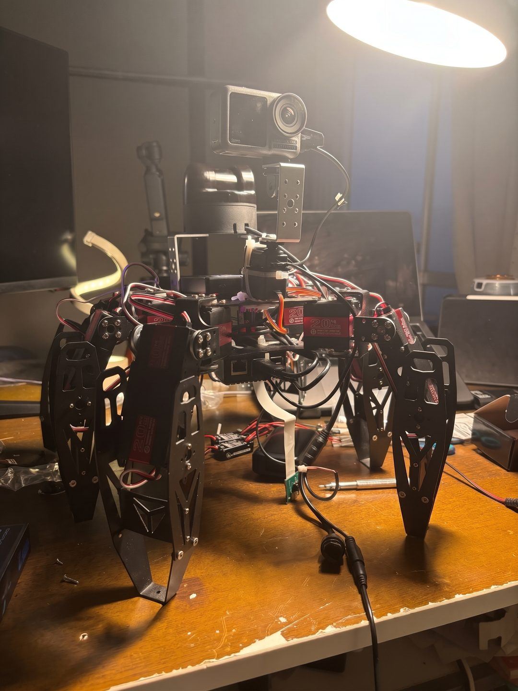<br><sub>Standing on its own legs</sub></td>
    <td width="50%" align="center">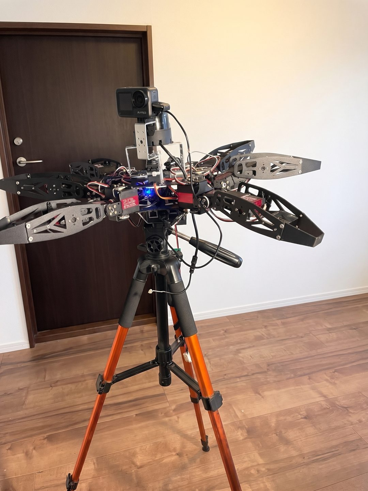<br><sub>On the tripod for bench tests</sub></td>
  </tr>
</table>

---

## How it connects

<p align="center"></p>

| Machine | What runs there | Why there |
|---|---|---|
| **Robot**<br>Raspberry Pi 4, 4 GB | Body loop at 50 Hz on core 0 (inverse kinematics, gait, balance) · LiDAR and IMU reflexes · command gateway · MQTT broker · fast voice (Whisper tiny, LFM2.5-350M, Piper) | Has to keep working with no network at all |
| **Home server**<br>i7-8700, 15 GB, no GPU | Brain (planner, skills, memory, dashboard) · Lowi on Telegram and WhatsApp · vision with LFM2.5-VL-1.6B · harder questions with LFM2.5-1.2B · Whisper small | Heavy work that can wait a second |
| **AWS**<br>EC2, on demand | An EC2 worker for 3D mapping (SLAM) that starts only for a job and stops itself (planned). Lowi left Lightsail for the home server on 2026-11-17 | Extra power for short jobs, billed by the hour. The robot never needs it |
| **AI cloud**<br>optional | Kimi on NVIDIA NIM, Claude, Gemini | Deep reasoning, only when the internet is up |
| **Your phone** | Telegram, WhatsApp, the dashboard, the Lowi app | Remote control always goes through the brain |
| **Your laptop** | Simulator, tests, deploys over SSH | Build and test without touching the hardware |

Only the home server holds AWS credentials, and they can only start, stop and check the mapping
worker. The Pi has none.

### One voice command, start to finish

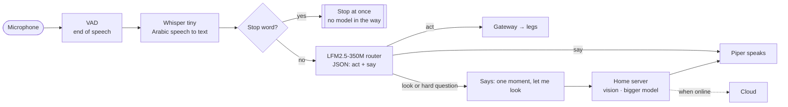

Moving and talking happen at the same time. Answers from vision or the cloud are **only spoken**:
they never move the robot, because a camera can read text that tries to give orders.

### Who answers, depending on the network

| Network | Who answers | Status |
|---|---|---|
| Internet and home server | Lowi, with cloud models when needed | Robot → server works today (answers in 1–2 s). Routing to Lowi is next |
| Home server, no internet | Lowi offline, with a local model on the server | In progress |
| Robot alone | Says *"No internet right now, but I'll answer you"* and replies from the Pi's small model. The chat is sent to Lowi later | In progress |

---

## Inside the robot

<p align="center"></p>

<details>
<summary><b>Parts list</b></summary>

| Part | Model | Job |
|---|---|---|
| Computer | Raspberry Pi 4, 4 GB, Raspberry Pi OS Lite 64-bit | Body loop, voice, gateway, broker |
| LiDAR | Unitree 4D LiDAR L2 with built-in IMU, on Ethernet | Obstacles, tilt, falls |
| Servo board | Lynxmotion SSC-32U on USB, 115200 baud | Turns joint angles into servo pulses |
| Servos | 18 × DSSERVO RDS3218 (270°) | 6 legs × coxa, femur, tibia |
| Servo power | 2 × UBEC at 6.0 V | Left legs and right legs |
| Camera | USB webcam (Brave 7 LE) | Photos on request |
| Audio | USB microphone, USB or 3.5 mm speaker | Voice in and out |
| Home server | Intel i7-8700, 15 GB RAM, no GPU, Ubuntu 24.04 | Brain, vision, Lowi |

</details>

<!-- PHOTO SLOTS: replace with docs/images/photos/robot-lidar.jpg, robot-legs.jpg -->
<table>
  <tr>
    <td width="33%">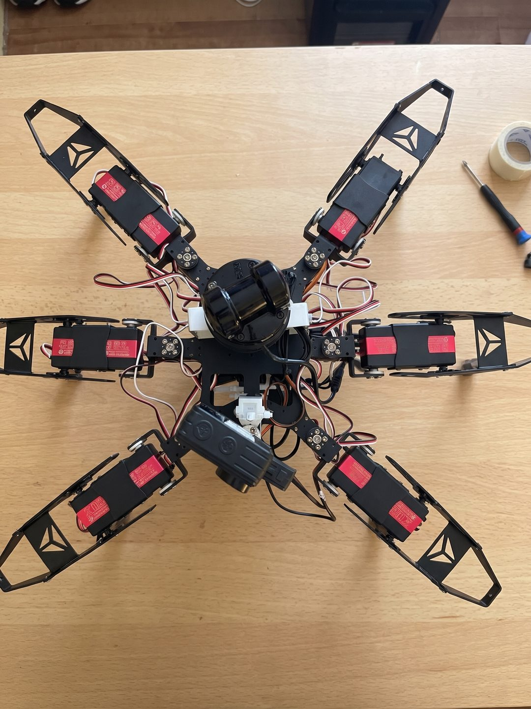</td>
    <td width="33%"></td>
    <td width="33%"></td>
  </tr>
</table>

---

## Telegram and WhatsApp

<p align="center"></p>

| | Telegram | WhatsApp |
|---|---|---|
| **Job** | Control: tasks, status, photos, approvals, E-stop | Conversation with Lowi, one to one or in groups |
| **You send** | Plain words, voice notes, or commands like `/photo what's on the table?` | Messages and voice notes |
| **Alerts** | Obstacle stop, fall, tilt, link lost, E-stop | Short alerts, with a cooldown per kind |
| **Who it answers** | Owner accounts only (`SB_TELEGRAM_OWNER_IDS`) | Runs on a secondary WhatsApp number |

Lowi keeps every word from every channel (voice, Telegram, WhatsApp, groups) in its memory.
Photos are kept only when you ask for one.

> [!IMPORTANT]
> Your Telegram account is the robot's key. Turn on two-step verification.

<details>
<summary><b>All Telegram commands</b></summary>

```text
Write or say anything: a question, a CV/email request, or a robot job.
/run <task>            multi-step robot task
/status  /scan         robot state and LiDAR summary
/photo [question]      camera photo, with a vision answer
/stand  /sit  /relax   posture
/stop  /estop  /release
/pause  /resume  /cancel
/record [seconds]  /map <job id>
/memory [query]  /forget <id>
```

Every action that needs approval comes with **Approve** and **Reject** buttons.

These commands are built into the brain's own bot ([`telegram.py`](spider-robot/brain/src/spider_brain/telegram.py)).
While Lowi serves Telegram, the brain's bot stays off, so there is only ever one bot.

</details>

---

## Simulator

The simulator runs the **real body code**: the same `Robot` class, gait, inverse kinematics and
safety rules, with fake servos and a simulated LiDAR room. If a move is unsafe, the simulator
refuses it exactly as the robot would.

<table>
  <tr>
    <td width="50%" align="center">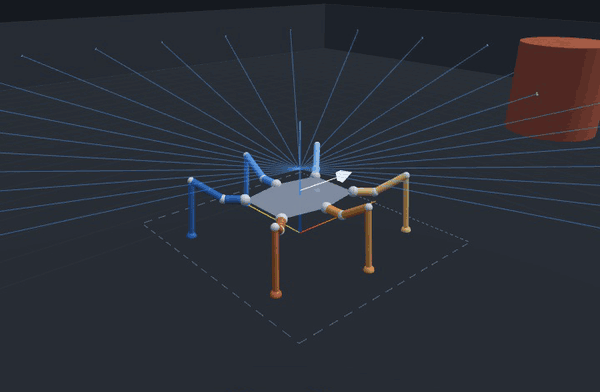<br><sub>Simulator: walk, turn, then “hi”</sub></td>
    <!-- PHOTO SLOT: replace with docs/images/photos/robot-walk.gif -->
    <td width="50%" align="center"><br><sub>The real robot (coming soon)</sub></td>
  </tr>
</table>

```bash
cd spider-robot/body
uv sync
uv run spider-sim-view --config config/robot.sim.yaml
# open http://127.0.0.1:8770
```

**Keys:** <kbd>W</kbd> <kbd>S</kbd> forward and back · <kbd>A</kbd> <kbd>D</kbd> sideways ·
<kbd>Q</kbd> <kbd>E</kbd> turn · <kbd>Space</kbd> stop · <kbd>Esc</kbd> E-stop.
The panel also has postures, three gaits and all 17 expressive moves.

<details>
<summary><b>See the control panel</b></summary>

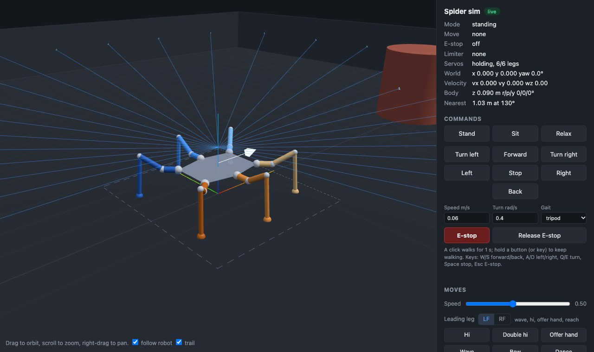

</details>

---

## Quick start

| I want to… | Needs | Go to |
|---|---|---|
| See it walk | A laptop | [1. Simulator](#1-watch-it-walk) |
| Check the code | A laptop | [2. Tests](#2-run-the-tests) |
| Run the whole stack on one machine | A laptop and Mosquitto | [3. Full stack](#3-run-the-full-stack-on-one-laptop) |
| Build the real robot | Pi 4, LiDAR, servos, a home server | [4](#4-set-up-the-robot) → [5](#5-set-up-the-home-server) → [6](#6-update-the-robot) |

**You need:** Python 3.11 or newer, [uv](https://docs.astral.sh/uv/), and internet once (the 3D view loads three.js).

### 1. Watch it walk

```bash
cd spider-robot/body && uv sync
uv run spider-sim-view --config config/robot.sim.yaml   # http://127.0.0.1:8770
```

### 2. Run the tests

```bash
cd spider-robot
for p in common body gateway voice brain; do (cd $p && uv sync --all-extras && uv run pytest -q); done
```

The same checks run on every push in GitHub Actions, together with `ruff`, a shell syntax check,
a secret scan and a build of the LiDAR bridge.

### 3. Run the full stack on one laptop

A local broker, the body with fake hardware, and the brain, which you drive by hand:

```bash
cd spider-robot
mosquitto -c infra/local/mosquitto-sim.conf &
(cd body && uv sync && uv run spider-body --config config/robot.sim.yaml --sim) &
cd brain && uv sync && uv run spider-brain teleop
```

### 4. Set up the robot

1. Flash **Raspberry Pi OS Lite 64-bit** with Raspberry Pi Imager, with SSH and Wi-Fi on. Fit a heatsink and a fan.
2. Join your Tailscale network:
   ```bash
   curl -fsSL https://tailscale.com/install.sh | sh && sudo tailscale up
   ```
3. Copy the `spider-robot/` folder to the Pi and install. This installs everything and **starts nothing that moves**:
   ```bash
   bash ~/spider-robot/infra/pi/setup_pi.sh
   ```
4. On your laptop, make the certificates for the broker's Tailscale listener. The CA key never leaves your laptop:
   ```bash
   cd spider-robot/infra/local
   BROKER_HOST=<pi-tailscale-name> BROKER_IP=<pi-tailscale-ip> bash make_local_certs.sh
   ```
   Copy `ca.crt`, `server.crt` and `server.key` to `/etc/mosquitto/spider/` on the Pi, and install `mosquitto-tls.conf`.
5. Point `/etc/spider/robot.yaml` at the servo board: run `ls /dev/serial/by-id/` and put that path in `ssc.port`.
6. Plug in the camera, microphone and speaker, then check them. It takes one photo, records 4 s and plays it back:
   ```bash
   bash ~/spider-robot/infra/pi/hw_check.sh
   ```
7. First motion, **with the robot on a stand and its legs in the air**:
   ```bash
   sudo -u spider /opt/spider/spider-robot/body/.venv/bin/spider-calibrate --config /etc/spider/robot.yaml check
   # then the same with: center, trim, direction
   sudo systemctl start spider-body
   spider-robotctl status
   spider-robotctl bench stand
   ```

> [!WARNING]
> Keep servo power off until calibration, with a motor power switch in reach.
> No walking on the floor until the hardware E-stop (relay, watchdog, fuse) has passed its tests.

### 5. Set up the home server

On Ubuntu 24.04, joined to the same Tailscale network:

```bash
cd spider-robot
bash infra/server/setup_server.sh            # builds llama-server, installs the brain and the models
# on a desktop still in use: START_MODELS=0 BUILD_JOBS=4 bash infra/server/setup_server.sh
```

Then put the brain's certificate in `/etc/spider-brain/certs/`, settings in
`/etc/spider-brain/brain.env` and secrets (bot token, API keys) in `/etc/spider-brain/secrets.env`,
and start it:

```bash
sudo systemctl enable --now spider-brain
```

The dashboard listens on `127.0.0.1:8765`. Share it to your phone with `tailscale serve`.

### 6. Update the robot

```bash
bash infra/pi/deploy.sh
```

It refuses unless the robot is sitting or relaxed, keeps the previous release, and goes back to it
by itself if a service does not come up.

<details>
<summary><b>Everyday commands on the Pi</b></summary>

| Command | What it does |
|---|---|
| `spider-robotctl status` | Mode, E-stop, link and LiDAR state |
| `spider-robotctl stop` | Stop now |
| `spider-robotctl estop` | Latch the E-stop |
| `spider-robotctl release` | Release the E-stop |
| `spider-robotctl bench stand` · `sit` · `relax` · `walk` | Bench tests, on a stand |

</details>

---

## Safety

The body never waits for the network to be safe. Every rule below runs on the robot:

| Rule | Limit |
|---|---|
| Obstacle ahead | Slows from 40 cm, stops at 15 cm from the leg tips |
| Tilt and falls | Starts walking only when level (±2°), stops above 30°, relaxes the servos at 55° (fallen) |
| Brain goes quiet | Stops after 1.5 s without a heartbeat |
| Old commands | Drops any command older than 1 s |
| One sender | Only the gateway may command the body. Stop beats local voice, which beats remote, which beats the planner |
| Hallucinations | A move runs only if you actually said its words. Vision and cloud answers are spoken, never acted on |
| Expressive moves | Each move is checked before it starts (support, reach, servo limits, joint speed) and refused whole, never cut off halfway |
| E-stop | Stays latched through reboots. Voice can never release it |

---

## Mobile app

<p align="center">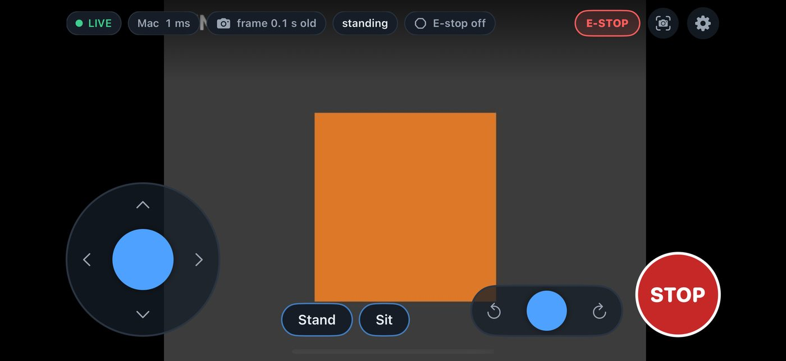</p>

The Lowi app for iPhone and iPad drives the robot from its own camera, from anywhere. It talks
only to the brain on the home server, over Tailscale. The phone never speaks MQTT and never
connects to the Pi, so the gateway's remote limits and the body's own limits apply to everything
it does.

- **Hold to drive.** The robot moves only while a thumb, a key or a controller stick is held: 1 s
  moves, renewed every 0.4 s. Let go, lose the link, or let the camera frame get older than 2 s,
  and it stops. The brain enforces the same dead-man on its side.
- **STOP on every screen.** It fires the moment a finger touches it and goes out two ways at once.
  E-stop is one tap. Releasing it shows a fresh photo and needs a long press, and works once.
- **Honest status.** Link, latency, frame age, mode, E-stop and the reason the robot is slowing
  down are always on screen. When driving is off, the controls grey out and say why.
- **Hold to talk.** Hold Talk and speak Arabic, Japanese or English, for up to 30 s. The brain hears it with
  Whisper, answers with the local model first, and the app plays the answer in Lowi's own voice. A spoken stop
  word sends STOP at once (about 1 s on the server). Talking never moves the robot.
- **iPad.** The camera next to a LiDAR radar, the robot's state, a photo with a question, and the
  event log. A keyboard (W A S D, Q E, Space, Esc) and game controllers work too.
- English and Japanese, Dynamic Type and VoiceOver.

<table>
<tr>
<td width="50%">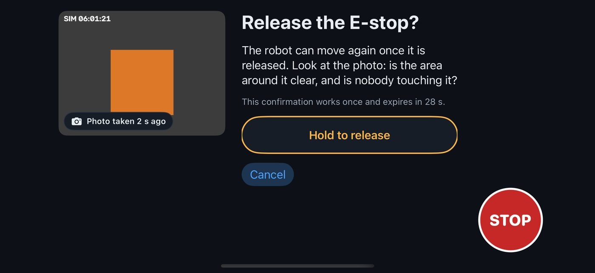</td>
<td width="50%">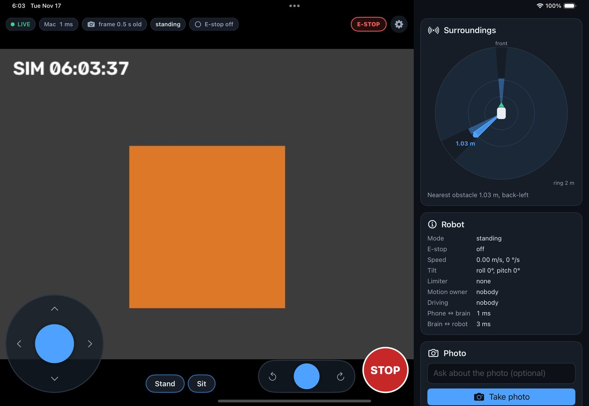</td>
</tr>
</table>

Remote limits today: 0.05 m/s, 0.3 rad/s, moves of at most 1 s. The screenshots come from the
simulator, whose camera shows a grey frame with an orange box. The app has been paired with the home
server from a real iPhone; driving with the body running is the next check. Setup, pairing and the API:
[spider-robot/mobile/README.md](spider-robot/mobile/README.md).

---

## Project layout

```text
spider-robot/
├── common/    shared wire protocol and MQTT link
├── body/      Pi: servos, IK, gait, LiDAR safety, camera, 3D simulator
├── gateway/   Pi: the only sender of commands to the body, console, E-stop button
├── voice/     Pi: VAD, Whisper, stop words, grammar, router, Piper
├── brain/     server: planner, Telegram, WhatsApp alerts, vision, memory, dashboard
├── infra/     setup scripts for the Pi, the home server and the local broker
└── docs/      architecture and the step-by-step plan
```

---

## Status and roadmap

| Stage | What | Status |
|---|---|---|
| Software | Body, gateway, voice, brain and simulator, with 717 tests | ✅ Done |
| Pi bring-up | OS, services, certificates, servo port, LiDAR, broker fault tests | ✅ Done |
| Home server | Brain, vision and planner models installed and answering the robot; Lowi moved here from AWS (2026-11-17) | ✅ Done |
| Whole chain | Brain to robot over Tailscale and mTLS: Stop acked 20 of 20 (12 ms median), E-stop latched in 23 ms, a photo answered by the server's vision in 7 s | ✅ Bench test, 2026-11-17 |
| Real-time check | One hour at 50 Hz under full load (P06) | ⏳ Next |
| Camera, mic and speaker | Camera fitted and checked: fresh photos, no missed body ticks. Mic and speaker next (`hw_check.sh`) | 🔨 Camera done |
| Lowi and the robot | Hard questions go to Lowi, with offline fallbacks | 🔨 In progress |
| First motion | Servo calibration and walking on a stand (P08) | 🔜 |
| Hardware E-stop and floor walking | Relay, watchdog, fuse, obstacle tests (P09) | 🔜 |
| Voice tuning | 200 recorded phrases and accuracy targets (P10) | 🔜 |
| Mobile app | iPhone and iPad: drive from the camera and hold to talk in Lowi's voice, with 32 unit tests and UI tests | ✅ Paired on a real iPhone |
| Edge sensors | VL53L1X stair-edge and side sensors | 🗓️ Planned |
| 3D mapping | LiDAR recordings to SLAM on an on-demand AWS worker | 🗓️ Planned |
| Raspberry Pi 5 (16 GB) | A strong offline Lowi on the robot itself, around March 2027 | 🗓️ Planned |

---

## Documentation

- [Architecture](spider-robot/docs/ARCHITECTURE.md): the agreed design, and what exists versus what is still to build
- [System design](spider-robot/docs/plan/01_SYSTEM_DESIGN.md) and [validation tests](spider-robot/docs/plan/06_VALIDATION.md)
- [Execution plan](spider-robot/docs/plan/04_EXECUTION_PLAN.md): every step, with commands and expected output
- Owner guides, in Arabic: [the Pi](spider-robot/docs/plan/SETUP_PI.md) and [the home server](spider-robot/docs/plan/SETUP_HOME_SERVER.md)

The diagrams in this README are drawn by [`docs/images/src/make_diagrams.py`](docs/images/src/make_diagrams.py).
Edit the text there and run `python3 docs/images/src/make_diagrams.py` to redraw them.
