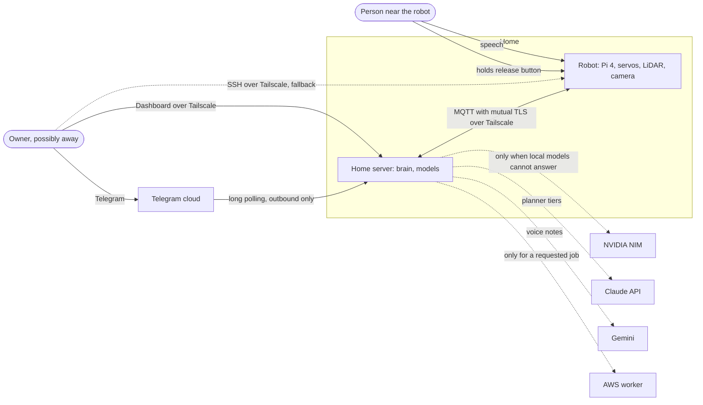
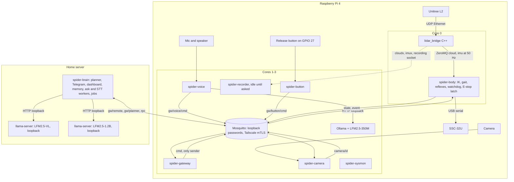
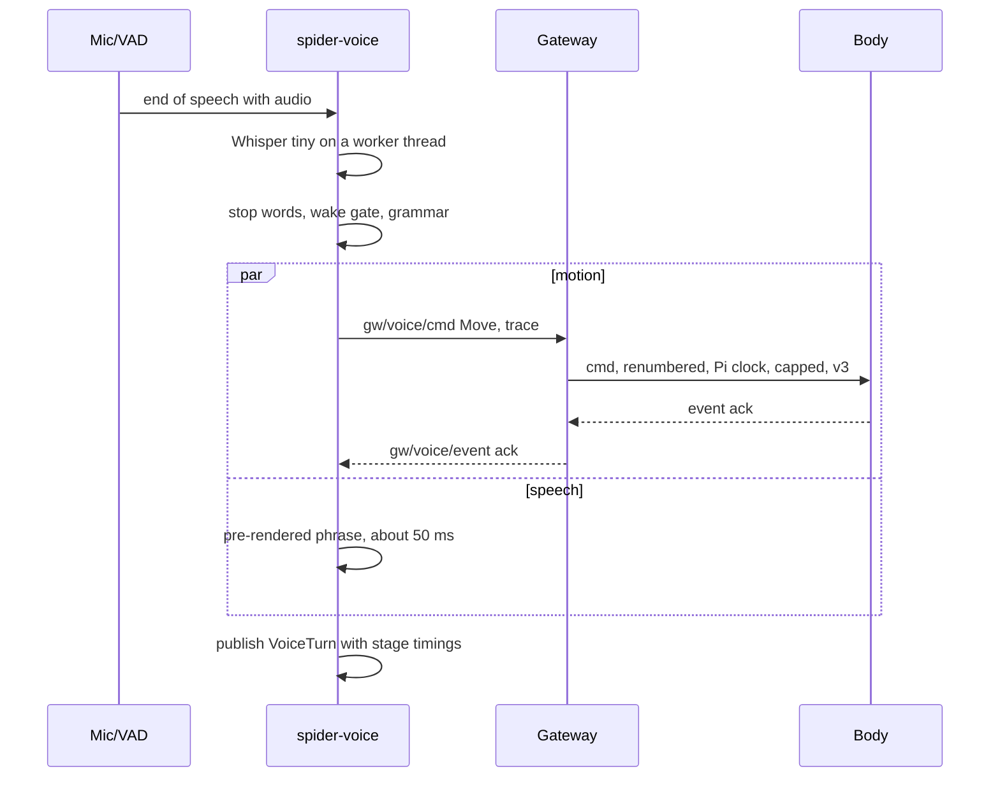
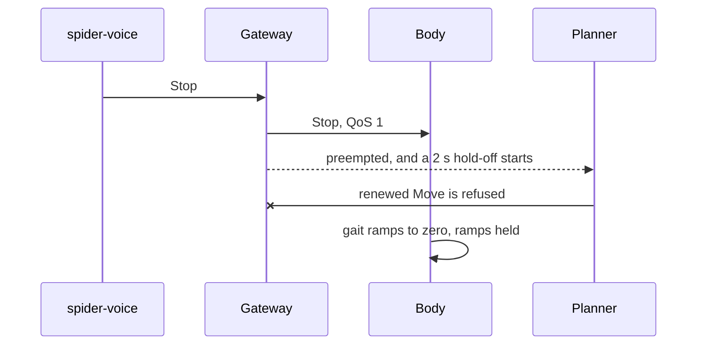
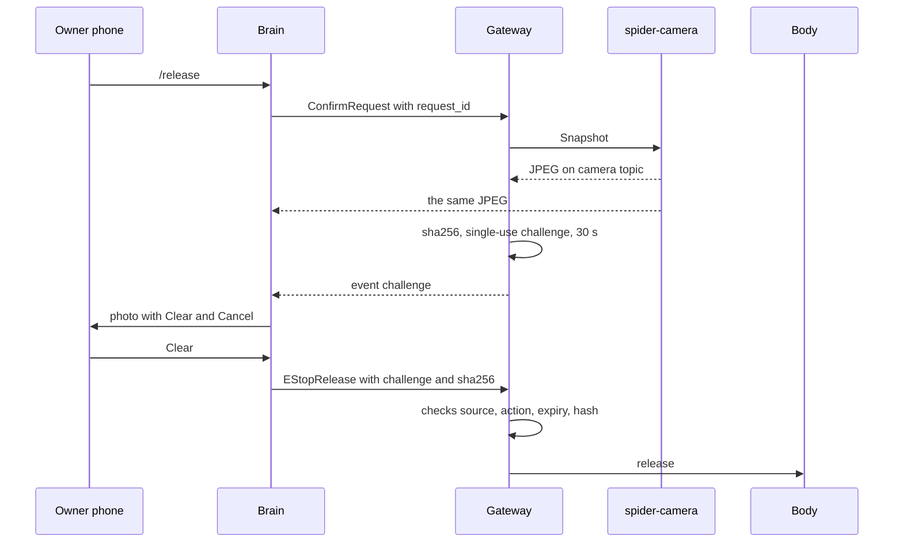
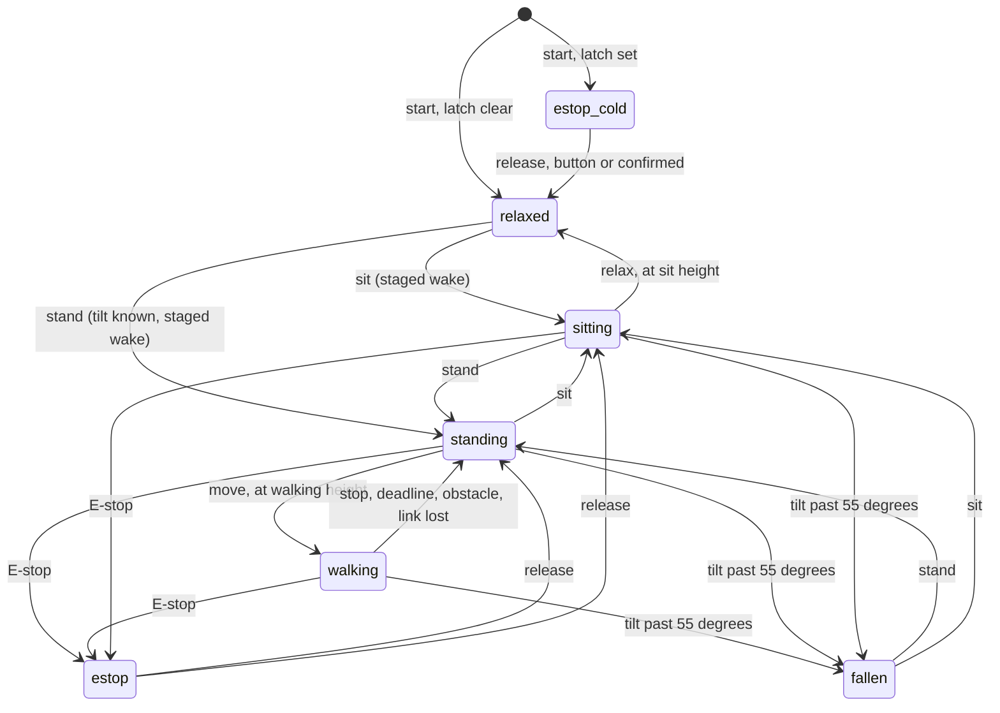

# Spider robot: system design

Status: merged design, 2026-11-10, after judge round 1. Audience: an engineer who has never seen this
project. Code for every part is in `04_EXECUTION_PLAN.md`.

**Labels used everywhere.** **[V]** verified: read in code or run on the Mac. **[S]** from a named
published source. **[E]** estimated, with the test that replaces it. **[A]** assumed. Nothing in this
design has run on the Pi, a real broker, the server or the robot. Test IDs are defined in section 9.

---

## 1. Requirements

### 1.1 Functional

| ID | Requirement | Verified by |
|---|---|---|
| F-01 | Walk, turn, stand, sit, relax on command, tripod gait by default | Unit, RT2 |
| F-02 | Every motion command expires by itself | Unit, RT2 |
| F-03 | Arabic voice commands offline: Stop, walk, turn, stand, sit, look | Pipeline tests, V1, V2 |
| F-04 | Arabic spoken replies offline | Adapter tests, V3 |
| F-05 | A stop word needs no wake word, no confidence and no model | `test_stop_word_*` |
| F-06 | Voice motion needs the wake word or a recent command | `test_background_speech_cannot_move_the_robot` |
| F-07 | Remote control from Telegram and the dashboard, through Tailscale | Brain tests, NET1 |
| F-08 | SSH fallback console works with the server down | `test_console.py`, NET3 |
| F-09 | Remote E-stop release needs a fresh frame and explicit confirmation, single use | `test_challenge_*` |
| F-10 | E-stop can be released with no network, by a person at the robot | `test_button.py`, B-E1 |
| F-11 | Vision and cloud answers are spoken only and cannot cause motion | `test_ask_reply_cannot_carry_an_action`, `test_vision_answer_*` |
| F-12 | Obstacle stop, tilt stop, fall detection, link watchdog, all on the robot | Body tests, RT3 |
| F-13 | LiDAR recording on request; mapping on the server or AWS on request | `test_recorder.py`, `test_jobs.py`, M7 |
| F-14 | STT, TTS, router and vision are selected by config | `registry.py`, `test_routing.py` |

### 1.2 Voice latency

"End of speech" is the last voiced frame. Each stage is logged per utterance in `VoiceTurn`.

| ID | Stage | Target | Status | Replaced by |
|---|---|---|---|---|
| L-01 | VAD hangover | 300 ms | **[V]** config | V1 |
| L-02 | Whisper tiny int8, 3 cores, short utterance | No fixed target; **[E] 3-8 s** | Nearby published figures only: tiny on a Pi 4 at 35 s per 100 s of audio; 13.8 s encoder on an old whisper.cpp build; a Home Assistant report of 5-6 s **[S]**. None is int8 Arabic on 3 cores | V1, B-V1 |
| L-03 | Stop-word match | ≤ 1 ms | **[E]** | V1 |
| L-04 | Grammar match | ≤ 1 ms | **[E]** | V1 |
| L-05 | Router, first readable act | p95 ≤ 3 s | **[E]** about 30 tok/s on a Pi 5 per one report whose page later returned 404 **[S, weak]**; a Pi 4 is slower | S1 |
| L-06 | Router, whole reply | ≤ 10 s, hard timeout | **[V]** config | S1 |
| L-07 | Fixed phrase, first audio | ≤ 150 ms | **[E]** pre-rendered in `prepare()` | V3 |
| L-08 | Piper, free text, first audio | p95 ≤ 700 ms | **[E]** | V3 |
| L-09 | Grammar command, end of speech to motion start | **[E] 3.4-8.4 s offline.** `max_motion_age_s` is 6.0 until V1 sets it, so the slow end would be discarded as stale, not executed | Sum of L-01, L-02, L-04, L-10, ramp | V4 |
| L-11 | **Spoken Stop to braking, offline** | **[E] 3.3-8.3 s. Cannot be under 1 s on this hardware** | L-01 + L-02 + L-03 + L-10 | V4 |
| L-11b | Spoken Stop to braking, if `stt.primary: whisper_server` is adopted | **[E] 1.3-2.4 s**, server reachable | Off by default, needs B-V1 | B-V1 |

**Voice Stop is not a fast path and is not the primary protection.** Self-expiring Moves and the
physical E-stop are. Whisper tiny's Arabic word error rate is **63.4% on FLEURS and 90.9% on Common
Voice 9 Arabic** (arXiv 2510.23319, Table 7) **[S]**. The second is closer to dialect speech. Expect
free-form Arabic to be unreliable; the small command vocabulary is what makes this workable.

The architecture document's under-300 ms router target is not achievable on a Pi 4 for a whole reply
**[E]**. Common commands skip the model through the deterministic grammar.

### 1.3 Stop and reflex latency

| ID | Path | Target to braking | Status | Test |
|---|---|---|---|---|
| L-10 | Gateway receives Stop → body braking | p99 ≤ 40 ms | **[E]** one 20 ms tick plus loopback MQTT | RT4 |
| L-12 | Telegram or dashboard Stop on LAN | p95 ≤ 300 ms after the server receives it | **[E]** | NET1 |
| L-13 | Same, through a Tailscale relay | p95 ≤ 800 ms | **[E]** third-party relay figures up to about 450 ms **[S]** | NET2 |
| L-14 | LiDAR sees obstacle → braking | ≤ 300 ms worst case | **[E]** 180 ms revolution + 83 ms cloud + 20 ms tick | RT3 |
| L-15 | Physical E-stop press → servo power off | ≤ 20 ms | **[E]** typical relay release | HW2 |
| L-16 | Source lost → braking | ≤ 1.75 s, and a remote Move has already expired by 1.0 s | **[V]** arithmetic | NET2 |

Braking at 0.25 m/s² from 0.12 m/s takes 0.48 s and 2.9 cm **[V]**.

### 1.4 Control loop

| ID | Metric | Target | Test |
|---|---|---|---|
| R-01 | Tick start lateness p99.9, full AI load | ≤ 5 ms | RT1 |
| R-02 | Lateness maximum in 1 h | ≤ 18 ms | RT1 |
| R-03 | Tick duration p99.9 | ≤ 6 ms | RT1 |
| R-04 | Ticks later than 40 ms | 0 per hour | RT1 |
| R-05 | Overruns | ≤ 1 per 10,000 ticks | RT1 |
| R-06 | `cyclictest` on core 0 under load, max | ≤ 2 ms | RT1 |

Servos get group moves at 25 Hz with 40 ms interpolation, so a few milliseconds of jitter is
mechanically invisible. These limits exist to catch stalls.

### 1.5 Availability per failure mode

| Failed alone | Stop | Local voice motion | Remote | Vision | Recovery target |
|---|---|---|---|---|---|
| Home server | ✓ | ✓ | Telegram no; SSH yes | No | Automatic on return |
| Wi-Fi | ✓ | ✓ | No | No | Automatic |
| Internet | ✓ | ✓ | LAN and direct tailnet yes; Telegram no | Local yes, cloud no | Automatic |
| Gateway | Body stops by watchdog ≤ 1.5 s | No | No | No | Restart ≤ 3 s |
| Broker | Body stops by watchdog ≤ 1.5 s | No | No | No | Restart ≤ 5 s |
| Voice service | Other sources work | No | ✓ | ✓ | Restart ≤ 5 s |

Voice-loop service availability: ≥ 99% over a 24 h soak (S2).

### 1.6 Resource ceilings

| Node | Item | Ceiling | How |
|---|---|---|---|
| Pi | Core 0 utilisation | ≤ 40% average | RT1 |
| Pi | RAM, all services | ≤ 2.5 GB of 4 GB | `MemoryMax=` |
| Pi | Swap | None | `setup_pi.sh` disables it |
| Pi | CPU temperature, full load | ≤ 80 °C | HW5 |
| Server | RAM, all Spider services | ≤ 5.0 GB | `MemoryMax=` |

### 1.7 Other

| ID | Requirement | Target |
|---|---|---|
| N-01 | Power-on to voice ready, no network | ≤ 90 s **[E]**, V5 |
| N-02 | Worst-case travel after total link loss during remote control | ≤ 6 cm **[V]** 0.05 m/s × 1.0 s + braking |
| N-03 | Worst-case travel for one voice command | ≤ 18 cm **[V]** 0.08 m/s × 2.0 s + braking; default command 9 cm |
| N-04 | Pi operates with no network indefinitely | M5, V5 |
| N-05 | No secret in the repository | CI secret scan |

---

## 2. Architecture

### 2.1 Context



### 2.2 Containers



No Kubernetes, no service mesh, no metrics database. Ten small processes on the Pi, each a systemd
unit, one Python process plus two model servers at home. Each is justified by a different failure or
resource boundary: the camera and recorder are separate so OpenCV and disk I/O stay off Core 0, the
button is separate so it needs nothing else to run.

### 2.3 Responsibilities and boundaries

| Component | Owns | Must never |
|---|---|---|
| `lidar_bridge` | L2 driver, work-mode provisioning, `cloud` and `imu` (averaged to 50 Hz), recording socket | Block on a subscriber |
| `spider-body` | IK, gait, servo output, reflexes, watchdog, persistent E-stop latch, final limits | Trust a sender; wait on a network; load OpenCV |
| `spider-gateway` | Priority, one session and sequence, caps, hold-off, source liveness, lateness, confirmed actions | Replace body limits; run models |
| Mosquitto | Routing, ACL | Persist messages across a restart |
| `spider-voice` | VAD, STT chain, stop words, wake gate, grammar, router, TTS, per-utterance record | Send to `cmd`; let an answer cause motion |
| Ollama | LFM2.5-350M inference | Listen beyond loopback |
| `spider-camera` | Snapshots, on cores 1-3 | Decide anything |
| `spider-recorder` | Recording on request, low-disk stop | Run during normal use (no socket when idle) |
| `spider-sysmon` | Pi health, Tailscale path, failed units | Decide anything |
| `spider-button` | Hold-to-release on GPIO | Send anything but `estop_release` |
| `spider-brain` | Planner with approvals, Telegram, dashboard, memory, vision routing, ask and STT workers, mapping jobs, alerts | Hold the only copy of a safety rule |
| `llama-server` ×2 | Vision and stronger LLM | Listen beyond loopback |

**Rule for placing a safety check:** if a compromised or buggy brain could bypass it, it belongs on
the Pi. That is why caps, hold-off and confirmation live in the gateway.

### 2.4 Key data flows

**Voice command, local**



**Low-priority motion interrupted by a voice Stop**



**Remote E-stop release**



**Offline E-stop release.** A person holds the button for 3 s → `spider-button` publishes
`estop_release` on `gw/button/cmd` → the gateway refuses it if any motion source owns the robot,
otherwise forwards it. Voice can never release.

**Question and vision, speech only.** `voice → rpc/ask/req → brain → local model, then cloud if
configured → rpc/ask/res/voice → TTS`. `AskReply` has no action field and a test pins its field set.

**Remote walk.** Owner → planner → policy and approval → `gw/planner/cmd` Moves of 1 s, renewed →
gateway caps and lateness check → body limits and reflexes.

**Mapping.** `/record 120` → `rec/cmd` → `spider-recorder` writes `.sprec` → `/map <job>` copies it
to the server, converts to a bag, starts the AWS worker, runs Point-LIO, copies the map back, stops
the worker. Recording never depends on AWS.

---

## 3. Contracts

`spider_common.protocol` is the single source of every schema. Prefix: `spider/<robot_id>/`.

### 3.1 Topics

| Topic | Direction | Payload | QoS | Retain | Rate | Timeout and behaviour |
|---|---|---|---|---|---|---|
| `cmd` | gateway → body, camera | `Command` | Move, heartbeat 0; others 1 | no | Heartbeat 4 Hz | Body stops after 1.5 s while moving; rejects older than 1.0 s, except Stop and E-stop |
| `state` | body → all | `RobotState` | 0 | no | 4 Hz; 0.2 Hz idle and relaxed | Stale over 1.5 s |
| `event` | body, camera → gateway | `RobotEvent` | 1 | no | On event | |
| `camera/<id>` | camera → all | JPEG ≤ 120 KB | 1 | no | On request | Requester timeout 8-10 s |
| `gw/<source>/cmd` | source → gateway | `Command` | Move, heartbeat 0; others 1 | no | Heartbeat 2-4 Hz | Source timeout 1.5 s |
| `gw/<source>/event` | gateway → source | `RobotEvent`, source's own seq | 1 | no | On event | |
| `gw/status` | gateway → all | `GatewayStatus` | 1 | **yes**, last will `online=false` | 1 Hz | New subscribers see it at once |
| `voice/turn` | voice → brain | `VoiceTurn` | 0 | no | Per utterance | Best effort |
| `rpc/ask/req` | voice → brain | `AskRequest` | 1 | no | Per escalation | Voice waits 45 s, then speaks a failure |
| `rpc/ask/res/voice` | brain → voice | `AskReply` | 1 | no | | Unknown `trace` ignored |
| `rpc/stt/req` | voice → brain | `SttRequest`, ≤ 400 KB base64 | 1 | no | Per unsure utterance | 4 s, then a 30 s breaker |
| `rpc/stt/res/voice` | brain → voice | `SttReply` | 1 | no | | Unknown `trace` ignored |
| `health/<service>` | each → brain | `HealthReport` | 1 | **yes**, last will `level=down` | 0.2 Hz | Missing shows as stale |
| `rec/cmd` | brain → recorder | `RecordRequest` | 1 | no | On request | |
| `rec/event` | recorder → brain | `RecordEvent` | 1 | no | On change | |

Sources: `voice`, `remote`, `planner`; `button`, which may send only `estop_release`; and `bench`, which exists only while `SG_BENCH=1`, for a person at the robot during M3 and M4.

ZeroMQ, Pi only: `ipc:///tmp/spider_lidar.ipc`, topics `cloud` and `imu` (50 Hz average);
`ipc:///tmp/spider_lidar_rec.ipc`, topics `cloudx` and `imux` for the recorder.

### 3.2 Commands

Common fields: `v`, `session` (≤ 64), `seq`, `ts`, `trace` (≤ 32). Unknown fields are rejected.

| Type | Fields | Limits |
|---|---|---|
| `move` | `vx`, `vy` ±0.5, `wz` ±2.0, `duration_s` (0,10], `gait` | Body 0.12/0.08 m/s, 0.6 rad/s. Voice 0.08 m/s, 0.5 rad/s, 2.0 s. Remote 0.05, 0.3, 1.0. Planner 0.06, 0.45, 1.0. Bench 0.12, 0.6, 3.0 |
| `stop` | | Always passes; 2 s hold-off on equal or lower sources |
| `estop` | | Always passes; latched in the body, on disk |
| `estop_release` | `challenge`, `frame_sha256` | Remote with a valid challenge, or the button |
| `posture` | `posture`, optional `challenge`, `frame_sha256` | Wake from limp: voice yes, remote with a challenge, planner never |
| `body_pose` | `height_m`, `roll_deg`, `pitch_deg`, `yaw_deg` | Priority applies |
| `snapshot` | `request_id` | Rate limited, 0.5 s per source |
| `heartbeat` | | An on-time heartbeat keeps a source alive |
| `confirm_request` | `action`, `request_id` | Remote only; consumed by the gateway, never forwarded |

### 3.3 Telemetry and events

`RobotState` carries `loop_late_max_ms`, `loop_late_p99_ms`, `loop_late_hist` (cumulative: <1, <2,
<5, <10, <20, ≥20 ms), `loop_overruns`, `loop_max_ms`, `rt_ok`.

`RobotEvent.kind` is a plain string so older readers tolerate new kinds: `ack`, `rejected`,
`obstacle_stop`, `tilt`, `fallen`, `link_lost`, `estop`, `move_done`, `online`, `offline`, `error`,
`snapshot_failed`, `preempted`, `challenge`, `clamped`. `ack`, `rejected`, `move_done`,
`snapshot_failed` go only to the sending source. Everything else reaches every motion source.

### 3.4 Gateway rules, in order

1. Unknown source ignored. Invalid payload `rejected`, not a sign of life. Version outside 2-3 refused.
2. Button source: only `estop_release`, not stale, not while a source owns the robot.
3. Measure lateness with `SourceClock`. A late message does not refresh liveness.
4. Stop or E-stop always pass: fence, clear owner, hold off equal and lower ranks, forward, tell the
   displaced owner.
5. Any other late command is refused. Limits: voice 0.5 s, remote and planner 0.75 s of excess delay.
6. Move: drop if fenced; refuse if held off; cap; claim by priority; forward.
7. Posture: wake rule; claim; forward.
8. Everything forwarded is renumbered, stamped with the Pi's clock and re-issued as v3.

### 3.5 Swappable interfaces

```python
class STT(Protocol):
    async def transcribe(self, pcm16: bytes, sample_rate: int) -> Transcript: ...

class TTS(Protocol):
    sample_rate: int
    def synthesize(self, text: str) -> AsyncIterator[bytes]: ...

class Router(Protocol):
    async def route(self, transcript: str,
                    on_act: Callable[[str], None] | None = None) -> RouterDecision: ...

class Vision(Protocol):
    async def ask(self, question: str, trace: str) -> str: ...
```

| Move | Change |
|---|---|
| STT to the server first | `stt.primary: whisper_server` in `voice.yaml` (only after B-V1) |
| Vision to another machine | `SB_VISION_URL` |
| Add cloud escalation | `SB_ASK_FALLBACK`, `SB_VISION_FALLBACK`, `SB_COMPAT_BASE_URL` |
| GPU server | `SB_STT_DEVICE=cuda`, `-ngl 99` in the two llama units |
| Router on another machine | `router.url` in `voice.yaml` |

### 3.6 Router contract

Schema in the Ollama `format` field: `act` enum `forward, back, left, right, stop, look, none`; `say`
string, `maxLength` 60. Options: temperature 0.1, `num_predict` 80, `num_ctx` 512, `num_thread` 3,
`keep_alive` -1, stream on, 10 s whole-reply timeout. Output that does not parse means `none`. The
token limit was measured with the real LFM2.5-350M tokenizer by both planners: worst case about 0.78
tokens per Arabic character, so 60 characters is about 47 tokens plus 12 for the JSON **[V, planners;
not re-run by the judge]**. `cross_check` runs before the early act and again on the final act: a
motion is accepted only if the owner's words name it and do not negate it. Whether Ollama enforces
`maxLength` in its grammar is unverified; S1 checks truncation.

### 3.7 Versioning and Pi-server compatibility

`PROTOCOL_VERSION` is 3. The gateway accepts sources from `MIN_SOURCE_PROTOCOL` 2 to 3 and always
re-emits 3. The body rejects anything else, before feeding its watchdog.

| Rule | Detail |
|---|---|
| Additive within a version | New fields have defaults |
| Update the Pi first | A new Pi accepts an old server; the reverse is not supported |
| Tolerant readers | Unknown event kinds and state fields are ignored |
| Strict writers | Commands reject unknown fields, so a typo cannot silently do nothing |
| Bump when incompatible | Removing or re-typing a field, or changing a unit |
| During a bump | Update both in one maintenance window, robot sitting |
| Pi-internal | Body, gateway, voice ship together from one release directory |

---

## 4. Budgets

Measured figures come from the Apple Silicon Mac. Pi figures multiply them by an assumed 6-10× for a
1.5 GHz Cortex-A72 **[E]**. RT1 replaces every Pi figure.

### 4.1 Pi Core 0

| Work | Rate | Mac measurement **[V]** | Share of Core 0 **[E]** |
|---|---|---|---|
| `Robot.tick` while walking | 50 Hz | p50 29 µs, p99 196 µs | 1.2% |
| SSC-32U write | 25 Hz | not measured | 0.5% |
| Cloud to sector map, merge | 12 Hz | p50 246 µs | 2.4% |
| ZeroMQ wake-ups through asyncio, including IMU | 62 Hz at `IMU_DECIMATE=10` | 212-296 µs per message (judge) | **8-18%** |
| State, commands, MQTT thread | low | | 1-2% |
| `spider-body` subtotal | | | **about 13-24%** |
| `lidar_bridge`, 64,000 points/s | continuous | not measured | 5-10% **[A]** |
| Residual kernel work | | | 2-5% **[A]** |
| **Core 0 total** | | | **about 20-39%, ceiling 40%** |

The ceiling is close at the top of that range. If RT1 shows Core 0 over budget, the first remedy is
to drain the ZeroMQ socket with `NOBLOCK` inside the tick, so that one wake-up handles all pending
messages, before any kernel change.

### 4.2 Pi Cores 1-3

Whisper, router and Piper run mostly in sequence for one utterance.

| Process | Idle | During an utterance **[E]** |
|---|---|---|
| `spider-voice` VAD and glue | 3% of one core | 3% |
| Whisper tiny int8 | 0 | 3 cores for 3-8 s |
| Ollama + LFM2.5-350M | 0 | 3 cores for several seconds |
| Piper | 0 | about 1 core for 0.3-0.7 s |
| Gateway, Mosquitto | 2% | 2% |
| `spider-camera` | 0 | 1 core for about 50 ms per frame |

Under sustained speech cores 1-3 are fully busy. **A heatsink and fan are required.**

### 4.3 Pi RAM

| Process | Estimate **[E]** | Ceiling |
|---|---|---|
| OS | 300 MB | none |
| `spider-body`, locked | 150 MB | 400 MB |
| `lidar_bridge` | 20 MB | 64 MB |
| Mosquitto | 8 MB | 64 MB |
| `spider-gateway` | 45 MB | 150 MB |
| `spider-camera` | 90 MB | 256 MB |
| `spider-recorder` | 45 MB | 200 MB |
| `spider-sysmon`, `spider-button` | 60 MB | 96 MB, 64 MB |
| `spider-voice` | 500 MB | 900 MB |
| Ollama + LFM2.5-350M Q4_K_M | 450 MB | 1 GB |
| **Sum** | **about 1.7 GB** | target ≤ 2.5 GB |

### 4.4 Home server

| Service | CPU | RAM **[E]** | Ceiling |
|---|---|---|---|
| `spider-brain`, including Whisper small int8 | under 5% average; 6 threads per STT | 900 MB | 2 GB |
| `llama-vision` LFM2.5-VL-1.6B | 6 threads, seconds per image | 1.6 GB | 3 GB |
| `llama-planner` LFM2.5-1.2B | 6 threads per request | 1.2 GB | 2.5 GB |
| **Sum** | | **about 3.7 GB** | |

This fits about 5.7 GB free in daily use, tightly. If it does not, drop the 1.2B model first. With a
later RTX 3060 12 GB, a build flag and `-ngl 99` move both models to the GPU, and nothing else changes.

### 4.5 Bandwidth

| Link | Traffic | Rate |
|---|---|---|
| Tailscale, normal | state, heartbeats, events | about 10 KB/s **[E]** |
| One camera frame | ≤ 120 KB | on demand |
| STT request | ≤ 400 KB | per unsure utterance |
| Recording copy | 1.5 MB/s of recording | off-line from the robot |
| Ethernet, L2 → Pi | 64,000 points/s plus IMU | 1.5-3 MB/s **[E]** |
| USB, Pi → SSC-32U | 4.2 KB/s of 11.5 KB/s **[V]** | |
| AWS upload, 10 min recording | about 900 MB | on demand |

### 4.6 Latency budgets

| Path | Stages | Total **[E]** |
|---|---|---|
| Spoken Stop to braking, offline | 300 ms VAD + 3,000-8,000 STT + 1 match + 15 MQTT + 20 tick | **3.3-8.3 s** |
| Grammar command to motion | Same + 60 ms visible ramp | **3.4-8.4 s** |
| Router command to motion | Same + first readable act | STT + up to 3 s |
| LiDAR to braking | 180 sweep + 83 cloud + 20 tick | **283 ms** |

At 0.12 m/s the reflex is 3.4 cm of travel plus 2.9 cm of braking, 6.3 cm of a 15 cm stop distance
**[V]** arithmetic.

---

## 5. Failure analysis

Test names are unit tests in the code, or bench and fault tests from section 9. Unit tests ran on
simulated hardware. Bench tests have not run.

### Network

| ID | Failure | Detection | Automatic response | Recovery | Test |
|---|---|---|---|---|---|
| N1 | Wi-Fi lost while walking under voice | None needed | Voice path is local; Moves expire | Automatic | NET3 |
| N2 | Wi-Fi lost under remote | Gateway sees no heartbeat | Move expires ≤ 1.0 s; Stop by ≤ 1.75 s; `link_lost` | Owner re-issues | `test_lost_owner_*`, NET2 |
| N3 | Tailscale on relay | `tailscale_path`, `queue_delay_ms` | Continues; caps bound motion | Automatic | NET2 |
| N4 | TCP stall, burst of old messages | `SourceClock` excess delay | Late commands refused; late heartbeats ignored; Stops pass | Automatic | `test_late_*`, `test_source_clock_*` |
| N5 | Internet down, LAN up | Cloud timeouts | Spoken failure; local fine | Automatic | NET4 |
| N6 | Commands arrive, telemetry does not | Brain telemetry stale 1.5 s | Brain ends the motion | Automatic | Brain tests, NET2 |
| N7 | Boot with no network | Local-only unit ordering | Broker, gateway, body, voice start | n/a | B-F1, V5 |

### Processes

| ID | Failure | Detection | Automatic response | Recovery | Test |
|---|---|---|---|---|---|
| P1 | `spider-body` crashes walking | systemd | SSC-32U holds last pose. Restart in 3 s, cuts pulses first | Owner stands it again | `test_startup_relaxes_*`, FI1 |
| P2 | `spider-body` hangs | `WatchdogSec=1` | Killed and restarted | As P1 | FI2 |
| P3 | Body and systemd both dead | GPIO 17 stops toggling | Relay cuts servo power at ≥ 200 ms | Power cycle | HW3 |
| P4 | Control tick raises | `MAX_TICK_ERRORS` | Relax after 0.5 s of failures, exit, restart | systemd | FI1 |
| P5 | `lidar_bridge` dies | Data age over 0.5 s, IMU over 0.3 s | No motion | systemd in 2 s | FI3 |
| P6 | Gateway dies | No heartbeats reach the body | Body stops at 1.5 s; last will | systemd in 1 s | `test_simulated_body_*`, FI4 |
| P7 | Broker dies | Clients disconnect | Body stops at 1.5 s | systemd in 1 s | FI5 |
| P8 | `spider-voice` dies | Last will on `health/voice` | Others unaffected; gateway stops its motion | systemd in 2 s | FI6 |
| P9 | Ollama hangs | 10 s timeout | Spoken failure; no motion | Next utterance | `test_ollama_times_out_as_a_whole`, FI7 |
| P10 | Whisper slow or hung | 20 s timeout, set from V1 | Turn failed. The worker stays counted as busy until its thread really ends. After 3 timeouts in a row health goes `degraded` and an alert fires | systemd if exhausted | `test_a_timed_out_transcription_*`, FI7 |
| P11 | `spider-camera` dies | Last will | `snapshot_failed` or timeout; release blocked, by design | systemd in 2 s | FI6 |
| P12 | Brain dies during a walk | Gateway sees heartbeats stop | As N2 | systemd | FI8 |
| P13 | Recorder dies mid-job | No `finished` | File readable to its last whole frame | Owner restarts | `test_a_truncated_file_*` |
| P14 | Out of memory | `MemoryMax`, sysmon | Offender killed and restarted; control process locked with the lowest OOM score | systemd | S2 |
| P15 | Whisper backlog during noise | `dropped` counter | Short utterances queue FIFO, bounded at 8; a long one cannot take the last worker; old motion discarded; Stop never | Automatic | `test_a_stop_among_many_*`, `test_a_motion_older_*` |

### Sensors and actuators

| ID | Failure | Detection | Automatic response | Recovery | Test |
|---|---|---|---|---|---|
| S1 | LiDAR stops sending | Age over 0.5 s | No translation or turn | Automatic | FI3 |
| S2 | IMU silent or disabled | Tilt age over 0.3 s | No motion; `stand` refused | Provision the work mode | HW1 |
| S3 | Partial sweep | By design | Nearest return over 3 clouds | n/a | `test_sector_*` |
| S4 | L2 warming up | As S1. Manual: no clouds until self-heated when below 30 °C **[S]** | No motion until data flows; runbook | Automatic | HW1 measures the time |
| S5 | Low or narrow object, drop | **Not detectable** | **None.** See H-02 | Mechanical change | HW1 |
| S6 | Microphone fails | `arecord` exits | systemd restart loop; health down | Fix device | FI6 |
| S7 | Camera fails | `snapshot_failed` | Spoken failure | Automatic | Unit |
| A1 | USB to SSC-32U unplugged | `SerialException` | Exit after 25 failed ticks; restart loop. SSC holds last pulses | Replug | FI9 |
| A2 | USB stalls | `out_waiting`, 10 ms timeout | Frame skipped | Automatic | Unit |
| A3 | Servo stalled or hot | **Not detected**, no current feedback | Fuse; physical E-stop | Inspect | HW4 |
| A4 | Servo brown-out | No sensor | Pi on a separate regulator | Battery | HW4 |
| A5 | Servo ignores loss of signal | Bench only | Software "relax" may not remove torque. **Only the power cut is reliable** | n/a | HW2 |

### Clocks

| ID | Failure | Response | Test |
|---|---|---|---|
| C1 | Pi clock wrong at boot, no RTC | Local path uses loopback passwords and one clock; nothing depends on the date | B-F1 with the clock at 2000-01-01 |
| C2 | Server clock skewed | Minimum-delay filter cancels a constant offset | `test_a_constant_clock_offset_*` |
| C3 | Clock step | Refused until a settled 3 s, then re-baselined | `test_source_clock_rebaselines_*`, FI10 |

### Power and thermal

| ID | Failure | Detection | Response | Test |
|---|---|---|---|---|
| T1 | Pi undervoltage | sysmon firmware flags | Health down; alert | HW5 |
| T2 | Thermal throttling | sysmon | Health down at 80 °C; alert | HW5, RT1 |
| T3 | Battery low | **No sensor** | Hardware low-voltage alarm, fitted at M4 | HW4 |
| T4 | Servo supply lost | None | Robot sinks to its belly | HW2 |
| T5 | Power loss during latch write | fsync then rename | Old or new value, never torn. A failed write raises an `error` event | `test_latch_*` |
| T6 | SD card failure | Filesystem errors, sysmon | Logs are volatile. Reinstall from `setup_pi.sh` | Runbook |

### Decisions and input

| ID | Failure | Response | Test |
|---|---|---|---|
| D1 | False stop word | Robot stops; safe | V2 measures the rate. Drop "بس" if false stops are high |
| D2 | False motion from background speech | Wake and confidence gates | V2 |
| D3 | LLM garbage or invented motion | Parser, `cross_check` | `test_a_stream_naming_*` |
| D4 | Robot hears itself | Echo gate: only a stop word can pass | `test_own_voice_*`, V3 |
| D5 | Instruction in the camera's view | Spoken only; stop words stripped | `test_vision_answer_*` |
| D6 | Reused or stale release | Single-use, hash-bound, 30 s challenge | `test_challenge_*` |
| D7 | Restart under E-stop | Persistent latch; no servo output until released | `test_latch_survives_*` |
| D8 | E-stop with no network | Hold-to-release button | `test_button.py`, B-E1 |
| D9 | Stale speech moves the robot | Discarded after 6 s | `test_a_motion_older_*` |

---

## 6. Physical safety

In the style of ISO 12100 (limits, hazards, risk estimate, then inherently safe design, safeguarding,
information for use) and the hazard groups of ISO 13482. **This is guidance for one owner building
one robot. It is not a conformity assessment and claims no certification.**

### 6.1 Limits

| Limit | Value | Status |
|---|---|---|
| Speed | 0.12 m/s in the body; 0.08 voice; 0.05 remote | **[V]** |
| Mass | 2-4 kg | **[A]** weigh it |
| Force at the foot | about 15 N | **[A]** |
| Users | Owner and adults at home; children and pets may be present | **[A]** |
| Environment | Indoor, flat floors | **[A]** |

### 6.2 Hazards

S 1-3, P 1-3, Risk = S × P before measures.

| ID | Hazard | S | P | R | Measures | Residual |
|---|---|---|---|---|---|---|
| H-01 | Fingers pinched | 2 | 2 | 4 | Low speed; expiring Moves; physical E-stop; keep clear | Low |
| **H-02** | **Walks into a low or narrow object, or off an edge the LiDAR cannot see** | 2 | 3 | 6 | Mount change (below); barriers near stairs; rule below | **High until the mount is changed. Medium after: no cliff detection** |
| H-03 | Falls off a table or stairs | 3 | 2 | 6 | As H-02; never on a raised surface; tilt detection | Medium |
| H-04 | Motion after an E-stop | 3 | 2 | 6 | Ramps frozen, persistent latch, physical cut | Low |
| H-05 | Motion on startup or after a crash | 2 | 2 | 4 | Startup cuts pulses, cold latch sends nothing, staged wake | Low |
| H-06 | Lithium battery fire | 3 | 1 | 3 | Fuse; LiPo bag; never charge unattended; alarm | Medium, inherent |
| H-07 | Stalled servo or UBEC overheating | 2 | 2 | 4 | Fuse; E-stop; watchdog relay | Medium: no current sensing |
| H-08 | Remote motion with someone near | 2 | 2 | 4 | 0.05 m/s; 1 s Moves; reflex; approvals | Low to medium |
| H-09 | Motion from background speech | 2 | 2 | 4 | Wake word, confidence, cross-check, short Moves, age limit | Low; V2 confirms |
| H-10 | Motion from prompt injection | 2 | 1 | 2 | Vision and cloud spoken only; cross-check; approvals | Low |
| H-11 | Tripping over the robot | 2 | 2 | 4 | Audible when moving | Medium, inherent |
| H-12 | Laser | 1 | 1 | 1 | L2 Class 1 **[S]** | Low |
| H-13 | Camera or mic privacy | 2 | 2 | 4 | Audio stays on the Pi unless escalated; owner-only | Medium |
| H-14 | Collapse on power loss | 1 | 2 | 2 | Belly drop about 5.5 cm **[V]** | Low |
| H-15 | Stop not heard or too slow | 2 | 3 | 6 | Moves expire by themselves; physical E-stop. Voice Stop is [E] 3.3-8.3 s | Medium |

**H-02: the blind band.** The L2 covers 360° × 90°, or 360° × 96° in NEGA mode **[S]**. In normal
mode nothing below the sensor plane is seen at all, so upright at 15 cm the limit is 15 cm at every
range. In NEGA the limit is about 11 cm at 0.40 m **[V]** arithmetic. At 216 scans/s and 5.55 Hz,
consecutive scans are 9.25° apart, so a chair leg at 0.5 m is hit by roughly one scan in three
**[E]**.

| Mount option | Sees low objects | Sees edges | Recommendation |
|---|---|---|---|
| A. Upright, as configured | No | No | Not acceptable for floor use |
| B. Tilted forward about 45° | Forward only | Forward only | Compromise; needs a `mount_pitch_deg` |
| C. Inverted on a mast at 30 cm or more | Yes | Possibly | **Recommended.** `imu_upside_down: true` flips points and IMU |

HW1 decides, with a 5 cm box and a 2.5 cm pipe at 0.5 m in at least 8 bearings. **Operating rule until
then: no walking near stairs or low obstacles without someone at the E-stop.**

### 6.3 States



`estop_cold` is `mode=estop` with an unknown pose. It sends nothing to the servos.

### 6.4 What each stop actually does

| Action | Category (IEC 60204-1 style) | Effect | Removes torque? | Survives restart? |
|---|---|---|---|---|
| `Stop` | 2, controlled | Velocity ramps down; height and pose ramps end; legs hold | No | No |
| Move expiry, obstacle | 2 | As Stop | No | No |
| Software E-stop | 2, latched | Feet and body freeze in one tick; only release clears it | **No** | **Yes** |
| Fall detected | 0 in software | Pulses stop | Depends on the servo (A5) | No |
| **Physical E-stop (M4)** | **0** | **Cuts servo supply upstream of both UBECs. Pi, LiDAR, logging stay on** | **Yes** | **Yes, mechanically latched** |
| Hardware watchdog (M4) | 0 | Same relay, drops if GPIO 17 stops toggling for 200 ms | Yes | Until the loop resumes |

**Plainly:** everything named "E-stop" in the code holds the servos under torque. Whether stopping
pulses even makes an RDS3218 limp is unknown; HW2 settles it.

### 6.5 Hardware to add at M4, before any untethered walking

Parts roughly $25-45 **[E]**: a mushroom-head twist-release normally-closed switch; a relay rated from
the HW4 current measurement between battery and both UBECs; a retriggerable timer on GPIO 17; a
momentary release button from GPIO 27 to ground; a battery fuse; a low-voltage buzzer; the Pi on its
own regulator.

### 6.6 Rules for first powered tests

1. Robot on a stand, feet off the ground, owner present, a tested way to cut power within reach.
2. `require_lidar: false` only on the stand.
3. First floor walking needs the physical E-stop fitted and HW2 passed.
4. The executor never starts motion on real hardware by itself.

Until M4 is complete there is no network-free E-stop release. The limitation is that a latched robot
with Wi-Fi down needs a keyboard on the Pi.

---

## 7. Security: STRIDE

Assets, in order: physical safety, the owner's home, credentials, API budget. Trust boundaries: phone
and Telegram; the tailnet; the Pi's loopback; the cloud.

| ID | STRIDE | Threat | Controls | Residual |
|---|---|---|---|---|
| T-01 | S | **Telegram account takeover** | Only owner IDs served; two-step verification required; caps, approvals, confirmed release; wake from limp needs a frame | Attacker has the owner's remote powers within the caps and sees the camera. Revoke and rotate the token |
| T-02 | S | Bot token stolen | `/etc/spider-brain/secrets.env` mode 600; long polling, no open port; `from.id` set by Telegram | Reads updates. Rotate |
| T-03 | S | A process claims another source | ACL binds each client to its own `gw/<source>/cmd`; identity comes from the topic | None within the broker |
| T-04 | S | Rogue MQTT client | `allow_anonymous false`; loopback passwords; mTLS on Tailscale; nftables | Local root on the Pi |
| T-05 | T | Commands altered in transit | TLS and WireGuard | Negligible |
| T-06 | T | **Prompt injection through the camera** | Vision has no tools. `AskReply` has only text; no path to a command. Planner receives results as untrusted, under approvals | A spoken lie; motion unaffected |
| T-07 | T | **Prompt injection through voice** | Wake gate; grammar first; `cross_check`; caps; stop words stripped from speech | Someone in the room can command the robot by voice, by design |
| T-08 | T | **Replay of a release** | Challenge single-use, bound to frame SHA-256, source, action, 30 s | None observed in test |
| T-09 | T | **Forged frame** | Gateway hashes the frame itself; camera topic write limited to the camera and body | A compromised Pi service |
| T-10 | T | Compromised brain forges confirmation | Frame rule enforced at the gateway; the Pi cannot verify a human | A compromised server can release with a real fresh frame. Physical E-stop unaffected |
| T-11 | T | **Memory poisoning** | Memory is planner context only; approvals still apply; `/forget` | A wrong fact affects planning, not limits |
| T-12 | R | Who commanded what | `trace` from utterance to motion; `VoiceTurn` on the server | Pi logs are volatile by design |
| T-13 | I | Camera or audio leak | Audio stays on the Pi unless a hard utterance goes to the owner's server; frames on request; cloud is opt-in | Cloud providers see what is sent when enabled |
| T-14 | I | Secrets in the repo | Placeholders; `.gitignore`; CI scan | A novel key format |
| T-15 | I | **Ollama or llama-server exposed** | All bind to 127.0.0.1. The Pi reaches models only over MQTT; no model port on the tailnet | None observed |
| T-16 | D | Message flood | Snapshot rate limit; bounded inboxes; broker queue limits; bounded speech backlog | A valid client flooding |
| T-17 | D | Loud audio keeps Whisper busy | Cores 1-3 only | Voice degraded |
| T-18 | D | Wi-Fi jamming | Motion expires; local voice remains | Remote lost |
| T-19 | E | Service compromise | `spider` user, `NoNewPrivileges`, `ProtectSystem=strict`, `ProtectHome` | All Pi services share one user. Accepted for one robot |
| T-20 | E | AWS credential abuse | Server only; start, stop, describe on one instance | Describe leaks inventory |
| T-21 | E | Supply chain | `uv.lock`, exact model tags, Ollama 0.40.15, llama.cpp v0.9.0, SDK commit | A malicious pinned release |
| T-22 | S | Dashboard reached by another device | Loopback only, `tailscale serve`, origin allowlist, per-run token | Stolen run token |
| T-23 | S | Button source spoofed | ACL: only `spider-button` writes `gw/button/cmd`; gateway accepts only a release | Physical access |

### Network policy

Pi firewall, `infra/pi/files/nftables-spider.conf`: 8883 only on `tailscale0`; 1883 and 11434 only on
loopback; SSH only from the tailnet or the home LAN; the L2 port only from `192.168.1.62`.

Tailscale ACL, set by the owner in the admin console. No model ports are granted:

```json
{
  "tagOwners": {"tag:robot": ["autogroup:owner"], "tag:server": ["autogroup:owner"],
                "tag:worker": ["autogroup:owner"]},
  "grants": [
    {"src": ["autogroup:owner"], "dst": ["tag:robot"], "ip": ["22"]},
    {"src": ["autogroup:owner"], "dst": ["tag:server"], "ip": ["443", "22"]},
    {"src": ["tag:server"], "dst": ["tag:robot"], "ip": ["22", "8883"]},
    {"src": ["tag:server"], "dst": ["tag:worker"], "ip": ["22"]}
  ]
}
```

### Secrets

| Secret | Location | Mode | Rotation |
|---|---|---|---|
| Broker passwords | `/etc/spider/secrets/<user>.mqtt`, hashed at `/etc/mosquitto/spider/passwords` | 400 / 640 | Delete a file and re-run `mqtt_passwords.sh` |
| CA key | Offline, on the owner's laptop | 600 | On compromise |
| Server and brain keys | `/etc/mosquitto/spider` (640, group mosquitto), `/etc/spider-brain/certs` (600) | as stated | 825 days |
| Telegram, API keys | `/etc/spider-brain/secrets.env` | 600 | On suspicion |
| AWS credentials | Server only, scoped | 600 | Quarterly. **The Pi never holds any** |

**Certificate rotation** affects only the Tailscale listener, because local control uses passwords (replace the files in place, so the broker never starts without them).
Delete the pair, run `make_local_certs.sh`, copy, restart Mosquitto or the brain. Check quarterly:
`openssl x509 -checkend 5184000 -noout -in FILE`. There is no revocation list: for a compromised
brain certificate, remove the user from the ACL, restart Mosquitto, and issue a new one.

---

## 8. Observability

Sized for one robot and one person: JSON lines, retained status, a page on the existing dashboard, a
handful of alerts.

**Logs.** `spider_common.obs.setup_logging` writes one JSON object per line with `svc`. On the Pi
journald is RAM-only at 64 MB, to protect the SD card.

**Correlation.** `trace` is created for each utterance, carried on the command, kept by the gateway,
returned on the body's events and the gateway's replies, and used for `AskRequest` and `VoiceTurn`.

```bash
journalctl -u spider-voice -o cat | jq 'select(.trace=="abc123")'
```

**Metrics.**

| Source | Signal | Where |
|---|---|---|
| Body | `loop_late_max_ms`, `loop_late_p99_ms`, `loop_late_hist`, `loop_overruns`, `lidar_age_s`, `limiter`, `rt_ok` | `state` |
| Gateway | Owner, per-source alive, age, queue delay, hold-off, pending challenges; counters `preempted`, `held_off`, `late_command`, `late_heartbeat`, `capped`, `busy`, `lost_owner`, `button_release` | `gw/status` |
| Voice | `stt_ms`, `route_ms`, `tts_first_ms`, `total_ms`, route, reason; `dropped` | `voice/turn`, `health/voice` |
| System | Temperature, throttle flags, memory, disk, failed units, Tailscale path | `health/system` |

**Health model.** OK: all healthy. Degraded: robot safe but something reduced (server down, relay,
thermal warning). Unsafe to move: body, LiDAR or IMU unhealthy.

**Alerts** go by Telegram, and WhatsApp where set up. Fall, tilt, obstacle stop, link lost, E-stop,
offline (10 s cooldown). CPU ≥ 80 °C, throttled now, memory under 300 MB, disk under 1 GB, failed
unit, no Tailscale path, a dead service (5 min cooldown). Past throttling is deliberately not an alert.

**Latency dashboard.** The existing dashboard gains panels over its authenticated websocket: voice
latency p50 and p95 per stage over the last 2000 turns, counts per route, sources, confirmations.
Records go to a JSONL file with one 10 MB rotation. `spider-voice-bench` computes the bench reports.

**Server health** is limited in this design: `spider-sysmon` runs on the Pi only. A dead brain shows
as its gateway sources going quiet. Add a server reporter at M8 if needed.

---

## 9. Testing

Automated tests ran on the Mac with simulated hardware. Everything from 9.2 on needs real hardware and
**has not run**.

### 9.1 Automated

| Level | What | Where |
|---|---|---|
| Unit | Protocol, IK, gait, safety, LiDAR merge, stop words, grammar, segmenter, echo gate, routing, policy, button | Each package's `tests/` |
| Contract | v2 accepted and re-issued as v3; unknown kinds tolerated; ACL contract for every client | `common/tests/test_contract.py`, `gateway/tests/test_acl_contract.py` |
| Adapter | Whisper, Piper, Ollama streaming, RPC STT and ask, with fakes at the engine boundary | `voice/tests/test_routing.py` |
| Simulator | Voice through the real gateway to the real body on a simulated robot; brain to gateway to body | `voice/tests/test_pipeline.py`, `gateway/tests/test_gateway.py`, `brain/tests` |
| Fault injection in software | Lost owner, late messages, clock steps, garbage, truncated recordings, hanging server, backlog | Throughout |
| Regression, safety | One test per defect where software can show it | `body/tests/test_safety_fixes.py` and others |

### 9.2 Real-time

| ID | Test | Pass |
|---|---|---|
| RT1 | `bench_jitter.sh 3600` with FIFO and mlock off, then on; `cyclictest -a 0`; `/proc/interrupts` diff; Core 0 load | R-01 to R-06 on the shipped setting, `rt_ok` true. Records the UVC interrupt rate |
| RT2 | 30 min walking in the air | No overruns beyond R-05; smooth |
| RT3 | Obstacle at 1 m, 20 runs at 0.12 m/s | Stops with at least 10 cm remaining, every run |
| RT4 | Stop through the real broker, scope or high-speed video | L-10 |
| B1 | Logic analyser on the SSC-32U line | No group-move gap over 45 ms |

### 9.3 Voice

| ID | Test | Pass |
|---|---|---|
| V1, B-V1 | 100 owner clips, 0.5-4 s, with `spider-voice-bench`. Also measure `chunk_length` for short windows, or record the fixed-window cost and whether a `whisper.cpp` short `audio_ctx` adapter is worth adding | Replaces L-02. If p95 is above 2.5 s, the `stt.primary` swap is permitted by the judge's ruling. Sets `max_motion_age_s` |
| V2, B-V2 | 200 clips, quiet and with gait noise; 30 min of TV audio; the 200-utterance corpus | Stop recall ≥ 95% quiet, ≥ 85% noisy; zero false motion on TV; records the false-stop rate |
| V3 | First-audio on 20 phrases; 30 min of robot speech with mic live | Replaces L-07, L-08; never acts on its own voice |
| V4, B-V4 | High-speed video, speech end to first leg movement. Then enable `stop_on_speech_onset` and walk in a quiet room | L-09, L-11. Onset stays off unless false stops ≤ 1 per 5 min |
| V5 | Everything disconnected; power on | Voice ready ≤ 90 s; all voice functions work |
| V6 | One image through `llama-server` and through Ollama, timed | Vision works; timeout set from measurement; records whether Ollama loads the projector |
| S1 | 100 Arabic prompts through LFM2.5-350M | ≥ 98% valid JSON; no truncation; replaces L-05 |
| S2 | 24 h idle plus an utterance a minute | No restart; memory flat within 10% |
| B-V3, B-V5, B-S1, B-S2 | Planner B's bench items, run with the above | As named in the roadmap |

### 9.4 Network

| ID | Test | Pass |
|---|---|---|
| NET1, B-N1 | `tailscale ping`; Telegram Stop | Direct connection; L-12 |
| NET2 | `tc netem delay 300ms 100ms loss 5%`, then pull Wi-Fi during a remote walk | L-13; ends by itself ≤ 1.75 s; never moves on stale commands |
| NET3 | Server off | Voice unaffected; console over SSH |
| NET4 | Block WAN | Local and server functions work |
| NET5 | `mosquitto_pub` every forbidden publish as each user, on the real broker; Pi clock set to 2000-01-01 | Every one refused; all local clients connect; a Stop reaches the body |
| B-F1, B-F2 | Boot with Wi-Fi off, `systemd-analyze critical-chain spider-body.service` | No wait on `network-online.target`; voice ready in 90 s; server off gives voice ready |

### 9.5 Fault injection on the Pi

Robot on the stand, walking in the air, unless noted.

| ID | Inject | Pass |
|---|---|---|
| FI1 | `kill -9` spider-body | Restart within 5 s; relaxes; does not move on its own |
| FI2 | `kill -STOP` spider-body | Killed and restarted within 2 s |
| FI3 | `kill -9` lidar_bridge | No motion within 0.5 s |
| FI4 | `kill -9` spider-gateway | Stops within 1.5 s; offline status visible |
| FI5 | `systemctl stop mosquitto` | Stops within 1.5 s; reconnect after restart |
| FI6 | `kill -9` spider-voice, spider-camera; unplug mic | Others unaffected; health shows down |
| FI7 | `kill -STOP` ollama | Router timeout; spoken failure; no motion |
| FI8 | Stop spider-brain during a remote walk | Stops by itself |
| FI9 | Pull USB to SSC-32U | Exits after 0.5 s; recovers on replug |
| FI10 | `date -s` forward 1 h on the server | Recovers ≤ 3 s; no motion on stale commands |

### 9.6 Hardware

| ID | Test | Pass |
|---|---|---|
| HW1 | Provision the work mode: set the IMU enable bit and an explicit NEGA choice, then verify. Azimuth histogram per cloud. Cold power-on to first cloud. 5 cm box and 2.5 cm pipe at 0.5 m in ≥ 8 bearings | `roll_deg` non-null; `stand` accepted; each object stops the robot or is recorded as not visible; mount decided; warm-up time recorded |
| HW2 | Switch with a scope on the rail; separately `P0` and feel torque | L-15; records RDS3218 behaviour without pulses |
| HW3 | Stop the toggling, scope the relay | Drops within 200 ms |
| HW4 | Clamp meter walking and at stall; test fuse and alarm | Figures chosen for relay and fuse |
| HW5 | 30 min full AI load; then undervolt | Below 80 °C with a fan; sysmon reports both |
| B6 | Stand from limp, watch for brown-out | No reset; records rail dip |
| B-E1 | Latch, Wi-Fi off, reboot, release by button only | Releases; a short press does not |
| B-F2 | 20 hard power cuts | Boots every time |

A failed gate stops progress. See `03_ROADMAP.md`.

---

## 10. Delivery

Nothing here has run on the Pi or the server. Shell scripts passed `bash -n` only **[V]**.

**Reproducible installs.** `uv.lock` per package, `uv sync --frozen`.

| Item | Pin |
|---|---|
| uv | 0.12.17 |
| Python on the Pi | 3.12, uv-managed in `/opt/spider/python` |
| Ollama | 0.40.15 |
| Router model | `hf.co/LiquidAI/LFM2.5-350M-GGUF:Q4_K_M` |
| Piper voice | `piper-voices` v1.0.0, `ar_JO-kareem-low` |
| faster-whisper, ctranslate2, piper-tts, webrtcvad-wheels | 1.2.1, 4.8.5, 1.8.0, 2.0.14.post1 |
| llama.cpp | v0.9.0 |
| Unitree SDK | commit `0e3c51f5` |
| Point-LIO | commit `18ed5976`, in the Dockerfile |

**systemd.** Mosquitto and Ollama are replaced as whole units: a drop-in cannot remove the packaged
`After=network-online.target` **[S: systemd.unit(5)]**. Safety units order only on local units.

| Unit | Node | CPU | Memory | OOM adj | Restart |
|---|---|---|---|---|---|
| `spider-lidar` | Pi | 0, Nice -10 | 64 MB | -900 | 2 s |
| `spider-body` | Pi | 0, FIFO 50, watchdog 1 s | 400 MB | -900 | 3 s |
| `mosquitto` | Pi | 1-3, Nice -5 | 64 MB | -800 | 1 s |
| `spider-gateway` | Pi | 1-3, Nice -5 | 150 MB | -700 | 1 s |
| `spider-voice` | Pi | 1-3 | 900 MB | +300 | 2 s |
| `ollama` | Pi | 1-3, Nice 5 | 1 GB | +500 | 3 s |
| `spider-camera`, `spider-recorder`, `spider-sysmon`, `spider-button` | Pi | 1-3 | 256, 200, 64, 64 MB | +200 | 2 s |
| `spider-brain` | server | | 2 GB | -200 | 5 s |
| `llama-vision`, `llama-planner` | server | Nice 10 | 3, 2.5 GB | +300 | 5 s |

System-wide on the Pi: default `CPUAffinity=1 2 3`, `irqaffinity=1-3` plus `spider-tune.sh`, journald
in RAM, Wi-Fi power save off, no swap.

**Config and secrets.** `/etc/spider/robot.yaml`, `voice.yaml`, `gateway.env`;
`/etc/spider-brain/brain.env`, `secrets.env`. Only examples are in git, with `REPLACE_...` placeholders.
Config is validated at start with unknown keys refused.

**Updating a running robot.** `infra/pi/deploy.sh` reads retained `gw/status` and **refuses unless the
gateway is online and the robot is sitting or relaxed; if it cannot read the status it refuses**. It
builds a new release, switches a symlink, restarts, checks every unit after 8 s, and switches back on
failure. Keeps three releases. Order: **Pi first, then server.** It updates Python code only: changes
to units, the ACL or the bridge need the matching install commands from `setup_pi.sh`.

**Rollback by hand:** `sudo ln -sfn /opt/spider/releases/<old> /opt/spider/spider-robot` and restart.

**CI** (`.github/workflows/spider-robot.yml`): per-package frozen sync on Python 3.12, ruff, pytest;
`bash -n`; JSON validity; secret scan; a real bridge build against the pinned SDK.

### Runbooks

**The robot will not move.** `mosquitto_sub -t 'spider/+/gw/status' -C 1` with the console login.
`limiter`: `lidar_stale` means LiDAR (service, cable, `192.168.1.x`, or still warming up below 30 °C);
`imu_stale` means the bridge or an IMU not provisioned. E-stop latched: release. Mode `relaxed` or
`fallen`: wake by voice or `/stand`. Held off: wait 2 s.

**E-stop latched and no network.** Hold the release button for 3 s. Before M4 fits the button, attach
a keyboard and run `sudo -u spider rm /var/lib/spider/estop.latch`, then restart spider-body.

**E-stop release fails remotely.** Check `/photo`: no frame means no release, by design.

**It keeps stopping while walking.** Check `stop_on_speech_onset`. If it is on and false stops rise,
set it false. If "بس" triggers false stops, remove it from `stop_words`.

**It does not understand.** Look at `voice/turn`: `transcript`, `route`, `reason`. If the text is
wrong, the mic or STT is the problem. If it is right and `no_wake_word`, say the wake word.

**Server down, need control now.** SSH to the Pi over Tailscale and run `spider-robotctl status`, `stop`,
`estop` or `release`. It is installed at `/usr/local/bin` and runs as the `spider` user. Voice and
reflexes are unaffected. If the server's clock is over 0.75 s from the Pi's, console commands other
than Stop may be refused as late while the brain also uses the remote source; stop the brain first.

**L2 commissioning (once).** `LIDAR_SET_WORK_MODE=<value> /opt/spider/bin/lidar_bridge`, with the IMU
enable bit set and an explicit NEGA choice, power-cycle, then verify `roll_deg` is non-null. The
manual contradicts itself on factory defaults **[S]**, so check rather than assume.

**Loop late alerts.** Check heat, then whether something reached Core 0:
`ps -eo pid,psr,comm | awk '$2==0'`. First remedy is the `NOBLOCK` drain (section 4.1). Do not use
`isolcpus` or `nohz_full` on Core 0: the stock Pi kernel `bcm2711_defconfig` has no `NO_HZ_FULL`
**[V, judge]**. Changing the core needs a written decision change citing a failed RT1.

**AWS running when it should not.** `aws ec2 stop-instances --instance-ids <id>`, then
`systemctl list-timers spider-autostop`.

**Power loss or SD failure.** Re-image, run `setup_pi.sh`, restore `/etc/spider` from backup.

**Telegram account compromised.** Revoke sessions, rotate the bot token, change owner IDs.

---

## 11. Cost

Monthly, USD. Prices read 2026-11-09 and 2026-11-10; third-party aggregators are marked. Volumes are
assumptions **[A]**.

| Item | Price | Source |
|---|---|---|
| Claude Opus 5.5 | $4 / $20 per MTok; cache read $0.20 | [claude.com/pricing](https://claude.com/pricing) |
| Claude Haiku 5.5 | $0.10 / $0.50 per MTok | Same |
| Gemini 2.5 Flash audio | about $1.00 per MTok; sources disagree | [Aggregator](https://www.morphllm.com/gemini-api-pricing) |
| NVIDIA NIM trial | Free, about 40 req/min, no SLA | [NVIDIA forum](https://forums.developer.nvidia.com/t/request-to-increase-nvidia-nim-api-rate-limit-from-40-rpm-to-250-300-rpm/372594) |
| Tailscale Personal | Free, non-commercial | [Tailscale](https://tailscale.com/docs/account/manage-plans/free-plans-discounts.md) |
| Electricity, Japan | about $0.229/kWh, date unknown | [GlobalPetrolPrices](https://www.globalpetrolprices.com/Japan/electricity_prices/) |
| EC2 c7i.2xlarge, Tokyo | $0.4494/h | [Holori](https://calculator.holori.com/aws/ec2/c7i.2xlarge/ap-northeast-1) (aggregator) |
| EBS gp3 | $0.08/GB-month us-east-1; Tokyo about 10% higher **[E]** | [AWS](https://aws.amazon.com/ebs/pricing) |

| Line | Home-only | Typical | Heavy AWS |
|---|---|---|---|
| Server electricity, 45 W, 730 h | $7.50 | $7.50 | $7.50 |
| Pi and robot electricity | under $1 | under $1 | under $1 |
| Claude planner | $0 | $2 | $4 |
| Gemini voice notes | $0 | $0.10 | $0.10 |
| Kimi on NIM | $0 | $0, trial | $0, trial |
| AWS compute, c7i.2xlarge, 60 h | $0 | $0 | $27 |
| AWS disk, 100 GB | $0 | $0 | $8.80 |
| AWS data out, 5 GB | $0 | $0 | under $0.50 |
| **Total** | **about $8.50** | **about $11** | **about $49** |

Claude basis **[A]**: 30 tasks a month of 5 steps. `SB_MAX_TASK_USD=1.0` caps one task; there is no
monthly cap. Guardrails: an AWS budget alarm before first use (HUMAN STEP), a 4 h hard stop and 15 min
idle stop on the instance, AWS off while no instance ID is set, every cloud route off until a key is
set. A stopped instance still bills its disk.

---

## 12. Architecture decision records

| ID | Decision | Alternatives rejected | Consequences |
|---|---|---|---|
| ADR-01 | Keep Python for the 50 Hz loop, conditional on RT1 | C++ tick (rewrite before evidence); microcontroller (more hardware) | Fast iteration; a measured gate. The remedy order is below |
| ADR-02 | systemd default affinity, IRQ steering, FIFO on the control thread, `mlockall`, 1 ms GIL interval, `LimitRTTIME` | `isolcpus` or `nohz_full` on Core 0 (stock kernel has no `NO_HZ_FULL`); PREEMPT_RT (no official package; limits are milliseconds) | No kernel change; reversible. RT1 runs FIFO off, then on |
| ADR-03 | Bound motion at the source: voice ≤ 2 s, remote and planner ≤ 1 s, in the gateway | Relying on a fast Stop; a continuous enable only | Worst-case travel is a known number. Caps can relax after the bench |
| ADR-04 | Judge lateness without trusting clocks; re-stamp | Require NTP; sender sequence windows | No NTP dependency. A permanent long delay looks like an offset; caps bound it |
| ADR-05 | Persistent E-stop; a cold process sends nothing | tmpfs latch; persist the pose | After a crash under E-stop, place the robot before standing |
| ADR-06 | Physical power cut before untethered walking | Software only | The only true Category 0 stop |
| ADR-07 | Stop words, then grammar, then LLM with `cross_check`, including negation | LLM for everything | Common commands skip the model; unlisted phrasing gets speech, not motion |
| ADR-08 | Wake word from the transcript | openWakeWord or Porcupine (no Arabic model found); Vosk | Every utterance costs an STT pass. A detector can be added at M8 |
| ADR-09 | `llama-server` for vision, loopback, reached through the brain | Ollama (sources conflict; untested) | A second runtime on the server; easy to reverse |
| ADR-10 | Camera as its own process | In the body (violates decision 3) | OpenCV leaves the control process |
| ADR-11 | Sector map: nearest return over 3 clouds | Per-sector swept tracking (more state; based on an overstated sweep figure); larger `cloud_scan_num` | A moving object can linger about 0.25 s, on the safe side |
| ADR-12 | Two broker listeners: loopback with passwords, Tailscale with mTLS. The TLS listener is a separate file, added only after its certificates exist | One mTLS listener (a wrong clock or expired certificate stops local control) | A wrong clock or expired client certificate cannot affect local control. A **missing server certificate file** still stops the whole broker **[E, source knowledge]**, so P03 installs the file last and says how to remove it |
| ADR-13 | Half-duplex echo gate | AEC (more CPU and integration risk) | Barge-in needs a raised voice. Revisit after V3 |
| ADR-14 | `.sprec` recording, converted on the server; Point-LIO in a container | rosbag on the Pi; FAST-LIO2 (no official L2 support found) | Nothing ROS on the robot |
| ADR-15 | Audio through `arecord` and `aplay`, 20 ms periods | PortAudio in process | Killing `aplay` is the barge-in |
| ADR-16 | Rank-based hold-off, single-use hash-bound challenge | Time fence for all sources; reusable frame id (both reproduced as defects) | A lower Stop cannot block voice; a voice Stop cannot be undone |
| ADR-17 | MQTT RPC is the only Pi-server channel | Direct HTTP (keys on the Pi, model ports on the tailnet) | One login, one ACL; `AskReply` cannot act |
| ADR-18 | Hold-to-release button as a separate gateway source | Voice release (a TV could release it); keyboard only | Adds one GPIO part at M4 |
| ADR-19 | Streaming router with early act, gated by `cross_check` | Blocking 3 s call (times out); unchecked early act | Motion can start before the reply ends, only if the words name it |
| ADR-20 | Speech-onset stop implemented, off by default | On by default (its own top risk, untested) | Bench decides |
| ADR-21 | A `bench` gateway source, off unless `SG_BENCH=1`, ranked below voice, only the console user may write it | Enabling voice or the brain before M3 (more unknowns on first motion); a test mode in the body (a bypass of the body's own paths) | M3 and M4 can move the robot through the normal path. `SG_BENCH=0` is restored at the end of P09 |

**If RT1 fails, in order:** drain ZeroMQ with `NOBLOCK` inside the tick; move the tick into a small
C++ library; add a microcontroller between the Pi and the SSC-32U. A move off Core 0 is only permitted
as a written decision change citing a failed RT1 (`rt.cpu` exists, defaulting to 0).

### Proposed changes to agreed decisions, as ruled by the judge

| Proposal | Ruling |
|---|---|
| Move control from Core 0 to Core 3 if RT1 fails | **Deferred.** Decision 2 stands |
| Do not treat voice Stop as the primary protection | **Accepted, no change to the decision** |
| Make local Whisper the offline fallback | **Deferred to B-V1.** Default stays local-first; the swap is one config line and needs the breaker, which exists |
| `kimi-k3.1-pro` has no API; use `moonshotai/kimi-k3` | **Accepted as a fact update** (NVIDIA, 2026-11-04) |
| Speech-onset pre-stop | **Accepted as an option, default off** |
| `irqaffinity=1-3` note on decision 2 | **Accepted** |

---

## Open questions, settled

| Question | Answer |
|---|---|
| Is the Python 50 Hz loop on Core 0 good enough? | **Conditionally yes.** The robot is statically stable in tripod gait and servos interpolate over 40 ms, so the risk is stalls of 100 ms or more, each with a named fix. RT1 proves it |
| `isolcpus`, IRQ affinity, `SCHED_FIFO`? | IRQ affinity yes. FIFO on the control thread, shipped on, RT1 also runs it off. `isolcpus` and `nohz_full` on Core 0 no. PREEMPT_RT no |
| Real voice latency and Arabic quality? | Only estimated: section 1.2. Benches V1, S1, V4 replace them |
| Does Ollama load the LFM2.5-VL projector? | **Unverified**: Liquid's pages conflict, and the planner's download was denied by the permission system. `llama-server` is the decision. V6 records it |
| MQTT over Tailscale against 1.5 s and 1.0 s? | Those limits now apply only on loopback. The Tailscale hop is judged by the gateway's `SourceClock` |
| Which SLAM and recording format? | Point-LIO (`mapping_unilidar_l2.launch`, Noetic) in a container, from `.sprec` (5.5 GB/hour **[V]** arithmetic) converted to a bag. Usability unverified until M7 |
| What runs where on each failure? | Sections 1.5 and 5 |
| Wake word and barge-in? | Half-duplex echo gate; barge-in candidates can only be stop words; stop words stripped from speech; motion needs a wake word or recent command, confidence, cross-check |
