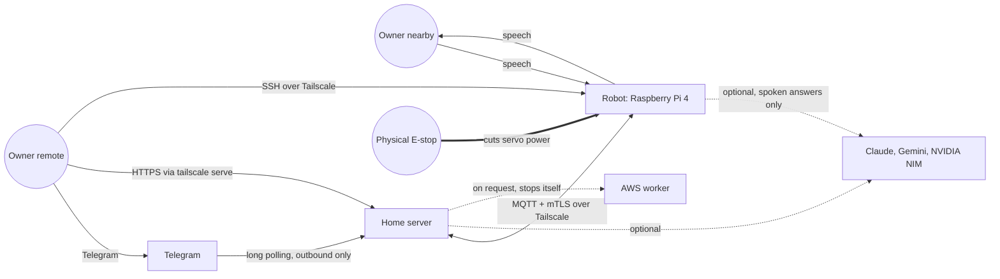
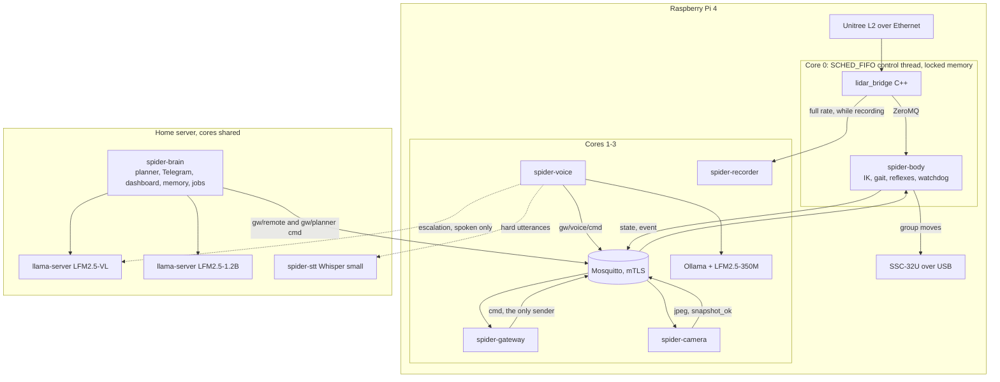
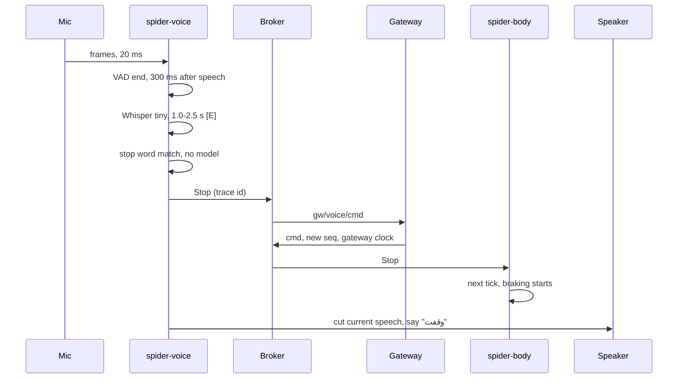

# 2. Architecture

## 2.1 Context



Placement rule (agreed decision 1): with the network gone, safety, motion and simple voice keep
working, because everything needed for them is on the Pi.

## 2.2 Containers



## 2.3 Responsibilities and ownership

| Component | Owns | Must never |
|---|---|---|
| `spider-body` | The state machine, IK, gait, tilt and obstacle reflexes, link watchdog, the E-stop latch | Wait on the network, load OpenCV, trust a command's values |
| `lidar_bridge` | L2 setup, packet parsing, IMU averaging, full-rate recording stream | Do anything but move sensor data |
| `spider-gateway` | Single session and sequence, priority, source liveness, lateness, caps, release rule | Replace the body's limits |
| Mosquitto | Routing and ACLs (decides which source a message is from) | Persist commands |
| `spider-voice` | Audio, VAD, STT, stop words, grammar, router, TTS | Talk to the body directly; let a cloud or vision answer produce a command |
| `spider-camera` | Capture and JPEG, answers Snapshot | Run on Core 0 |
| `spider-recorder` | Writes LiDAR to disk on request | Affect the control loop |
| `spider-brain` | Planner, Telegram, dashboard, memory, jobs, the two-step release UI | Publish to `cmd`; speak MQTT to a phone |
| `spider-stt`, `llama-server` | Inference | Listen on anything but the tailnet |
| AWS worker | Processes a copy of a recording, stops itself | Hold robot credentials |

The gateway is the only publisher to `spider/<id>/cmd`; the broker ACL enforces this.

## 2.4 Key data flows

### Spoken Stop



### Grammar command (for example "يا لوي امشي قدام")

Mic → VAD → Whisper → no stop word → confidence gate → wake gate → grammar hit → `Move` (0.06 m/s,
1.5 s) and canned phrase, in parallel. The Move expires by itself. The Trace id follows the command to
the body's `ack` and `move_done` events.

### Free-form command

As above, but no grammar hit, so: LFM2.5-350M returns `{act, say}` → `cross_check` compares `act` with
the owner's words → the act and the speech run in parallel. Output that does not parse is `none`.

### "شوف" (vision)

Filler phrase at once. Snapshot through the gateway to `spider-camera`. JPEG to `llama-server` on the
server, or the next service in the config list if that fails. The answer is sanitised and **spoken
only**. There is no code path from this answer to a command.

### Remote walk

Telegram → brain, planner source → tool → 1 s Moves renewed every 0.5 s (`robot_client.py:266-271`) →
gateway applies caps and lateness checks → body. If the link dies: the Move expires within 1.0 s, and
the gateway separately detects the lost source in at most 1.75 s.

### Remote E-stop release

```mermaid
sequenceDiagram
    participant O as Owner
    participant B as Brain
    participant G as Gateway
    participant C as spider-camera
    participant S as spider-body
    O->>B: /release
    B->>G: Snapshot (remote)
    G->>C: forwards; records who asked
    C->>B: JPEG
    C->>G: snapshot_ok (request id)
    B->>O: photo, Confirm and Keep buttons
    O->>B: Confirm, within 12 s
    B->>G: EStopRelease(frame_id, confirmed)
    G->>G: confirmed? same source? frame under 15 s old?
    G->>S: EStopRelease
```

The confirmation is enforced in the brain. A compromised brain could forge `confirmed=True`; it could
not forge a frame the gateway saw requested and delivered. `PLAN_07_security.md` covers what remains.

### On-demand mapping

`/record 60` → recorder on the Pi writes `.sprec` → `/map <job>` → the brain copies it over Tailscale,
converts it to a bag, starts the AWS instance, uploads, runs Point-LIO, fetches the map and stops the
instance. A timer on the instance stops it anyway.

## 2.5 Swappable parts

Interfaces in `voice/src/spider_voice/interfaces.py`; selection only in `registry.py`; choices in
`voice.yaml`:

```yaml
stt:       {primary: whisper_local, escalate: whisper_server}
tts:       {primary: piper, fallback: espeak}
router:    {kind: ollama, url: http://127.0.0.1:11434, model: "hf.co/LiquidAI/LFM2.5-350M-GGUF:Q4_K_M"}
escalation:
  vision:  [{url: "http://spider-server:8081/v1", model: LFM2.5-VL-1.6B}]
  answer:  [{url: "http://spider-server:8080/v1", model: LFM2.5-1.2B-Instruct}]
```

Adding a service is one adapter plus config. Moving one to another machine is a URL. A GPU server
later changes only URLs and model names.
