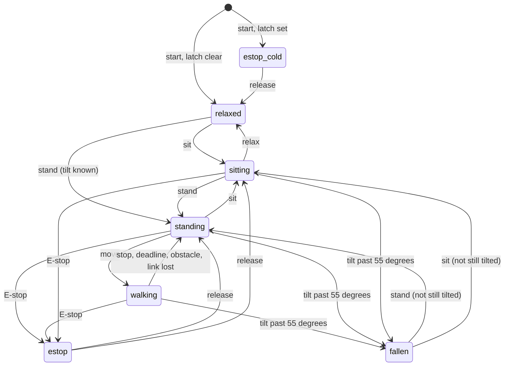

# 6. Physical safety

This follows the style of ISO 12100 (limits, hazard identification, risk estimation, then the
three-step reduction order: inherently safe design, safeguarding, information for use) and the hazard
groups of ISO 13482. **It is guidance for one owner building one robot. It is not a conformity
assessment and claims no certification.**

## 6.1 Limits of the machine

| Limit | Value | Status |
|---|---|---|
| Speed | 0.12 m/s in the body, at most 0.08 m/s by voice, 0.05 m/s remote | **[V]** config and policy |
| Mass | 2-4 kg | **[A]** weigh it |
| Leg force at the foot | about 15 N, from about 20 kgf·cm at a 13 cm tibia | **[A]** datasheet check |
| Supply | Two 6 V UBECs (`robot.example.yaml:48`), battery unknown | **[A]** |
| Users | Owner, adults at home. Children and pets may be present | **[A]** |
| Environment | Indoor, flat floors | **[A]** |
| Foreseeable misuse | Placing it on a table; running it near stairs; leaving it on unattended | Addressed below |

## 6.2 Hazards

Severity S: 1 minor, 2 needs treatment, 3 serious. Probability P before measures: 1 rare to 3 likely.
Risk = S × P. Residual is after measures, given honestly.

| ID | Hazard | S | P | Risk | Measures, in the 12100 order | Residual |
|---|---|---|---|---|---|---|
| H-01 | Fingers pinched in a moving leg | 2 | 2 | 4 | Low speed; Moves expire; **hardware E-stop**; keep hands clear (information) | Low. Servo force remains while powered |
| **H-02** | **Walks into a low object or off an edge the LiDAR cannot see** | 2 | 3 | 6 | **Mount change**, below; operate only behind physical barriers near stairs (information) | **High until the mount is changed. Medium after: no cliff detection in this plan** |
| H-03 | Falls off a table or stairs | 3 | 2 | 6 | As H-02; rule: never on a raised surface; tilt detection cuts torque after a fall | Medium |
| H-04 | Motion after an E-stop | 3 | 2 | 6 | D2-D5 fixed; persistent latch; hardware cut | Low |
| H-05 | Unexpected motion on startup or after a crash | 2 | 2 | 4 | Startup cuts pulses; a cold latch sends nothing; first motion on a stand | Low |
| H-06 | Lithium battery fire | 3 | 1 | 3 | Fuse at the battery; LiPo bag for charging; never charge unattended; low-voltage alarm | Medium, inherent |
| H-07 | Servo or UBEC overheating when stalled | 2 | 2 | 4 | Fuse; hardware E-stop; hardware watchdog relay for a hung Pi | Medium: no current sensing |
| H-08 | Remote motion with a person near, unseen | 2 | 2 | 4 | Caps: 0.05 m/s; 1 s Moves; obstacle reflex; approvals; camera on request | Low to medium |
| H-09 | Motion from background speech | 2 | 2 | 4 | Wake word, confidence gate, lexical cross-check, short Moves | Low. V2 confirms |
| H-10 | Motion from prompt injection | 2 | 1 | 2 | Vision and cloud are spoken only; lexical cross-check; approvals | Low |
| H-11 | Tripping over the robot | 2 | 2 | 4 | Audible and visible when moving (information) | Medium, inherent to a small floor robot |
| H-12 | Laser exposure | 1 | 1 | 1 | L2 is Class 1 **[S]** | Low |
| H-13 | Camera or microphone privacy | 2 | 2 | 4 | Audio stays on the Pi unless escalated; frames on request; owner-only access | Medium: see security part |
| H-14 | Sudden collapse on power loss | 1 | 2 | 2 | Belly-down drop of about 5.5 cm **[V]** from geometry | Low |
| H-15 | Stop not heard | 2 | 2 | 4 | Moves expire by themselves; hardware E-stop | Low to medium. L-11 is about 3 s |

### H-02: LiDAR mounting decision

The L2 sees a hemisphere plus 6°. Upright at 15 cm, nothing shorter than about 11 cm is visible at the
stop distance (index, open physical finding).

| Option | Sees low objects | Sees edges | Cost | Recommendation |
|---|---|---|---|---|
| A. Upright, as configured | No | No | None | **Unacceptable for floor use** |
| B. Tilted forward about 45° on a mast | Forward only | Forward only | Bracket; a config for tilt | Good compromise, needs an extra `mount_pitch_deg` in software |
| C. Inverted on a mast at 30 cm or more | Yes, all round | Yes, could be detected | Bracket; `imu_upside_down: true` exists; legs occlude part of the view | **Recommended** |

Software for option C is in `code.patch`: `imu_upside_down: true` now flips the points as well as the
IMU, as a 180° rotation about the sensor's x axis. If the bracket rotates about y instead, the map
comes out mirrored front to back, and `mount_yaw_deg: 180` corrects it. HW1 checks the sector map
against real objects before any walking. Until then the operating rule stands: no walking near stairs
or low obstacles without someone at the E-stop.

## 6.3 States

`estop_cold` is `mode=estop` with an unknown pose. Commanded transitions are guarded by the gateway
and the body together. A Stop always works and changes no latch.

## 6.4 What each stop actually does

| Action | Category (IEC 60204-1 style) | Effect | Removes torque? | Survives restart? |
|---|---|---|---|---|
| `Stop` | 2, controlled | Velocity ramps down at 0.25 m/s²; height and pose changes end; legs hold | No | No |
| Move expiry or obstacle | 2, controlled | As Stop | No | No |
| Software E-stop (voice, Telegram, dashboard, console) | 2, latched | Feet and body freeze within one tick; pose held; only release clears it | **No** | **Yes** |
| Fall detected | 0 in software | Pulses stop | Depends on the servo (A5) | No |
| **Physical E-stop (fitted at M4)** | **0** | **Cuts the servo supply upstream of both UBECs. Pi, LiDAR, and logging stay on** | **Yes** | **Yes: mechanically latched** |
| Hardware watchdog (M4) | 0 | Same relay, drops if the control loop stops toggling for 200 ms | Yes | Until the loop resumes |

**Honest statement:** at baseline there is no way to remove servo power except pulling a cable.
Everything named "E-stop" in the code holds the servos under torque. Whether stopping the pulses even
makes an RDS3218 go limp is unknown: digital servos vary **[S]**, and the code's own comment asks for
a bench check (`hw/servos.py:212`). HW2 settles that.

### Hardware to add (M4, before any untethered walking)

Parts cost roughly $25-45 **[E]**.

- A mushroom-head, twist-release, normally-closed switch, on the robot.
- A relay or contactor rated for the worst-case servo current, between the battery and both UBECs.
  Eighteen servos can draw tens of amps at stall **[A]**, so choose from a measured figure (HW4).
- A retriggerable timer that holds the relay on only while GPIO 17 toggles (`watchdog_gpio`).
- A fuse at the battery, and a low-voltage buzzer.
- The Pi on its own regulator, so a servo brown-out cannot reset it.

### Rules for first powered tests (required)

1. Robot on a stand, feet off the ground, owner present, a tested way to cut power within reach.
2. `require_lidar: false` only on the stand.
3. First walking on the floor needs the physical E-stop fitted and HW2 passed.
4. The executor never starts motion on real hardware by itself.
