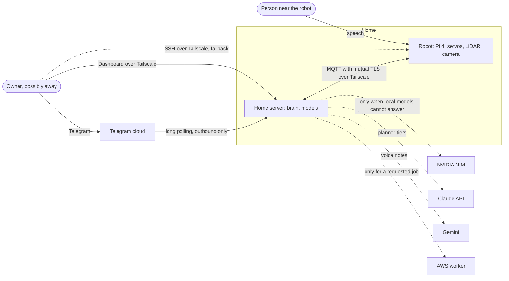
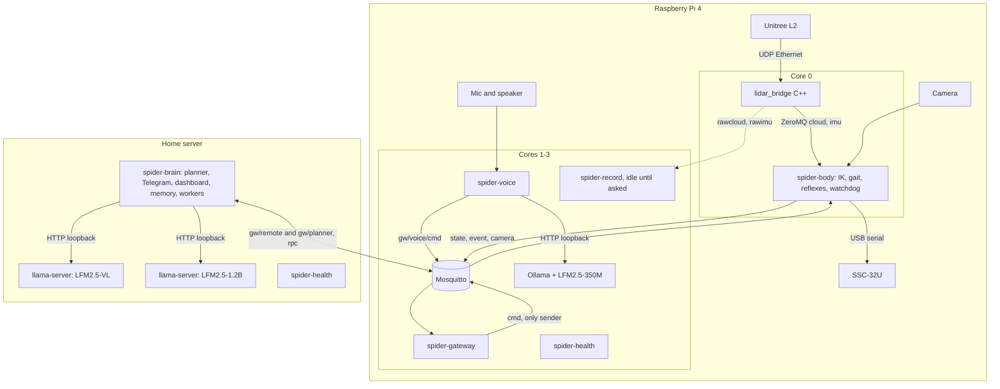
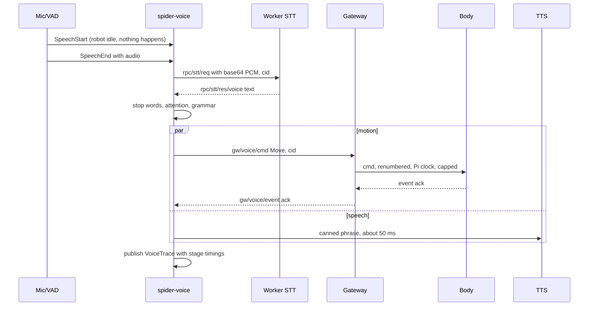
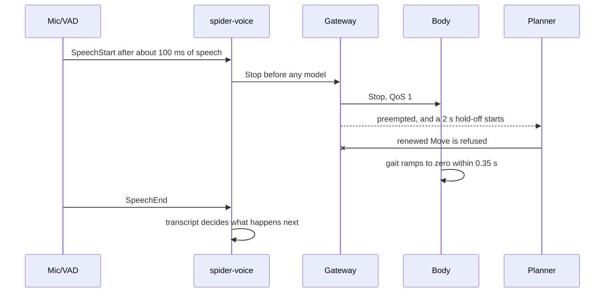
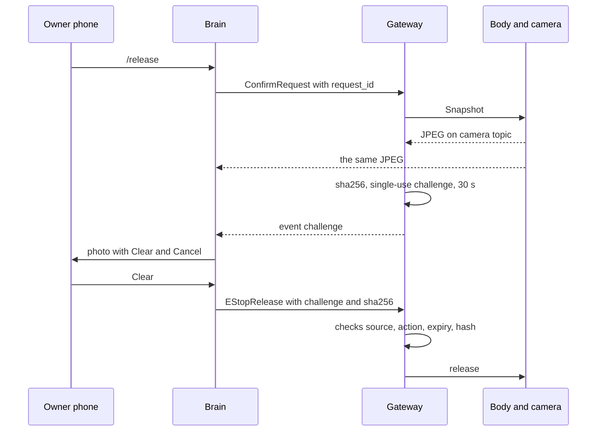

# 2. Architecture

## 2.1 Context

## 2.2 Containers

No Kubernetes, no service mesh, no time-series database. Eight small processes on the Pi, each a systemd unit, and one Python process plus two model servers at home.

## 2.3 Component responsibilities and boundaries

| Component | Owns | Must never |
|---|---|---|
| `lidar_bridge` | L2 driver; decimated `cloud` and `imu`; raw topics | Block on a subscriber |
| `spider-body` | IK, gait, servo output, reflexes, watchdog, E-stop latch, final limits | Trust any sender; wait on a network |
| `spider-gateway` | Priority, one session and sequence, source caps, hold-off, source liveness, queue delay, confirmed actions | Replace body limits; run models |
| Mosquitto | Message routing, ACL | Persist messages across restart |
| `spider-voice` | VAD, STT chain, stop words, attention, grammar, router, TTS, traces | Send to `cmd`; let an answer cause motion |
| Ollama | LFM2.5-350M inference | Listen beyond loopback |
| `spider-record` | Recording on request | Run during normal use (no socket when idle) |
| `spider-brain` | Planner with approvals, Telegram, dashboard, memory, vision routing, ask and STT workers, mapping jobs, alerts | Hold the only copy of a safety rule |
| `llama-server` x2 | Vision and stronger LLM | Listen beyond loopback |
| `spider-health` | Node facts for alerts | Decide anything |

**Rule for placing a safety check:** if a compromised or buggy brain could bypass it, it belongs on the Pi. That is why caps, hold-off and confirmation live in the gateway, and Telegram only shows the frame and sends the answer.

## 2.4 Key data flows

### Voice command, online

### Speech while moving: the fast Stop

### Remote E-stop release

### Question and vision: speech only

`voice -> rpc/ask/req -> brain -> local model, then cloud if configured -> rpc/ask/res/voice -> TTS`. `AskReply` has no action field, and a test pins its exact field set (`test_ask_reply_cannot_carry_an_action`). Even an answer reading "walk forward" is only said aloud (`test_answer_from_vision_is_only_spoken`).

### Remote walk (Telegram task)

Owner -> brain planner -> policy and approval (`policy.py`) -> `gw/planner/cmd` Moves of 1 s renewed every 0.5 s (`robot_client.py:266-271`) -> gateway applies caps and queue-delay check -> body limits and reflexes.

### Mapping job

`/record 120` -> `record/cmd` -> `spider-record` opens its socket, writes SPLR to `/var/lib/spider/recordings`, stops at `max_s` -> `/map <job>` copies it to the server with rsync, converts, runs Point-LIO in Docker. `/map <job> aws` starts the worker first, copies over Tailscale, runs there, copies the map back, and shuts the worker down. Recording never depends on AWS.

## 2.5 Why these interfaces

| Choice | Why it fits one developer |
|---|---|
| MQTT is the only Pi-server channel | One login, one ACL, one thing to debug. The server opens no model ports. Moving a worker needs no change on the Pi |
| Protocols plus a registry in `factory.py` | One adapter plus one config line adds a model. Vendor SDKs are imported only in `adapters/` |
| YAML for voice, `SB_` env for the brain | Follows what exists |
| No shared database | JSONL traces and retained status cover one robot |
