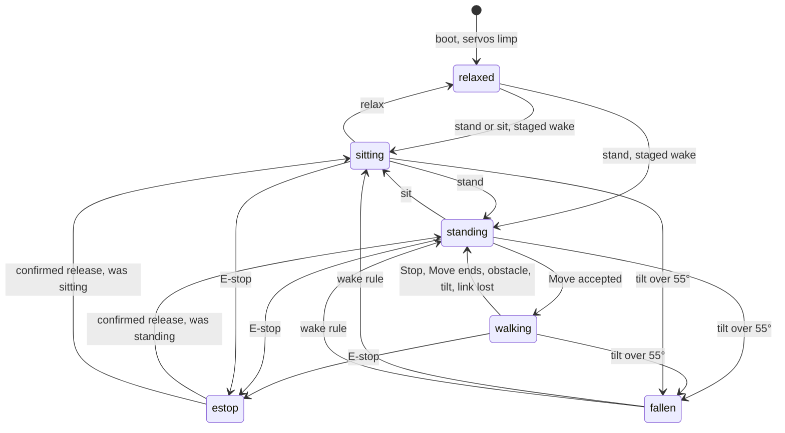

# 6. Physical safety

Guidance in the style of ISO 12100 and ISO 13482. **This is not a certification claim**, and no standard text was consulted beyond general familiarity. A hobby robot with one owner still deserves the discipline.

## 6.1 Machine limits

| Item | Value | Label |
|---|---|---|
| Mass | Not measured; 2-4 kg assumed | [A] |
| Footprint | Half-extents 0.24 x 0.27 m | [V] body `config.py:89-90` |
| Standing height of joints | 0.09 m | [V] body `config.py:84` |
| Top speed, body limit | 0.12 m/s | [V] body `config.py:102` |
| Voice speed | 0.08 m/s; cap 0.10 m/s | [V] |
| Remote and planner speed | cap 0.06 m/s | [V] |
| Servo stall torque | 25 kg·cm at 6.8 V, seller data | [A] |
| Servo stall current | 2.5 A each, 45 A for all 18, seller data | [A] |
| Use | Indoors, flat floor, owner's home | [A] |

## 6.2 Hazards

S: 1 minor, 2 injury treatable at home, 3 needs medical care. P: 1 unlikely, 2 possible, 3 likely, before measures.

| ID | Hazard | Situation | Harm | S | P | Measures | Residual |
|---|---|---|---|---|---|---|---|
| Z1 | Pinch between femur and tibia, or at the coxa | Hand on a leg during wake-up or walking | Finger pinch | 2 | 3 | Legs wake one at a time; remote cannot wake without a frame; hardware E-stop; speed caps. **Keep hands off while powered** | Medium |
| Z2 | Sudden servo jump | First command after limp ignores `T` (SSC guide p.25) | Pinch, servo damage | 2 | 3 | Staged wake; limp at start; a person places it on its belly first | Medium |
| Z3 | Robot walks into a person | Remote or autonomous motion | Bump, trip | 1 | 2 | LiDAR corridor; slow speed; pre-stop on speech; caps; `guarded` approvals | Low |
| Z4 | Falls off a table or stairs | **The LiDAR height band ignores the floor, so a drop looks clear** | Robot damage, falls on a foot | 2 | 2 | **No cliff sensing exists.** Rule: floor only, never on a table except on a stand. Open item for remote use near stairs | **High until mitigated** |
| Z5 | Battery fire | LiPo damaged or over-discharged | Burns, fire | 3 | 1 | Charge outside the robot, on a fire-safe surface, never unattended; voltage alarm | Medium |
| Z6 | Wiring overheats | 45 A worst case through thin wire | Burns, fire | 3 | 1 | Fuse on each UBEC input; wire rated for stall; two UBECs (`robot.example.yaml:48`) | Low |
| Z7 | Motion nobody asked for | LLM, injection, bug | Bump | 2 | 2 | Gateway rules, caps, short Moves, answers cannot act | Low |
| Z8 | Hot servo or Pi | Touched after long use | Minor burn | 1 | 2 | Duty limits; temperature alert | Low |
| Z9 | LiDAR laser | Class stated by Unitree is not verified here | Eye | 2 | 1 | Check the manual's class before use | Open |
| Z10 | Remote operator cannot see a person | Decision 8 | Bump or pinch | 2 | 2 | Tighter caps; a fresh frame before wake or release; `guarded` | Low to medium |
| Z11 | Stop not heard | Noise; robot speaking | Continues up to one Move | 2 | 2 | Short Moves end by themselves (2 s); blind window about 1.45 s; hardware E-stop | Low |

## 6.3 States

| Transition | Who may cause it |
|---|---|
| Any to Stop or E-stop | Anyone, always |
| `relaxed` or `fallen` to active | Voice (someone is there); remote with a fresh frame; **planner never** |
| `estop` to active | Remote with a fresh frame, or power cycle. Voice and planner may not |
| `walking` | Owner of the motion by priority, within caps, with fresh LiDAR, known tilt, level body |

Body limits (`robot.py`, `safety.py`) apply in every case.

## 6.4 What the E-stop actually cuts

| Level | Trigger | What happens | What is **not** cut | Release |
|---|---|---|---|---|
| Stop | Word, speech onset, button | Ramp to zero in ≤0.5 s, servos hold | Power, torque | Next command |
| Software E-stop (exists) | Word "طوارئ", Telegram, dashboard | Latched. Gait freezes in place, feet hold where they are, Moves refused (`robot.py:132-138`) | **Servo power and full holding torque. The legs can still pinch.** | Confirmed flow only |
| Limp | `relax`, a fall | SSC stops pulses; servos go slack. **`#nP0` is not in the SSC-32U guide: B6 must prove it** | Power to the servos | Staged wake |
| **Hardware E-stop (to add, HUMAN STEP)** | Latching mushroom switch | Opens the feed to VS1 and VS2. Robot drops about 9 cm to its belly | Pi and SSC logic, so it can log and report | Twist to release, then a staged wake |
| Battery disconnect | Person | Everything off | - | - |

**Wiring requirement, before first walking test.** The SSC-32U has separate logic power: the guide lists VL for when "you want to cut the power to the motors but keep the logic powered" [V, guide p.15]. So:

- Power the Pi and VL from their own regulator, never from the servo rail.
- Put the E-stop switch (or a contactor it drives, rated above 50 A peak) between the battery and both UBEC inputs.
- A fuse on each UBEC input.
- Keep it reachable. A wireless relay is a later option.

A hardware E-stop with no software path is intentional: software cannot prevent it, and it works when the Pi is dead.

## 6.5 First-motion procedure (HUMAN STEPs)

1. Robot on a stand with legs free, owner present, hand on the hardware E-stop.
2. `require_lidar: false` only for this stage.
3. Prove E-stop cuts VS1 and VS2 with a multimeter.
4. Prove limp: send `relax`, feel for slack.
5. Prove staged wake with no load.
6. First stand on the floor, belly down, hands clear.
7. Short walk at 0.03 m/s with `require_lidar: true`.

The executor must not start any of these.

## 6.6 Open safety items, stated plainly

- **No cliff or edge detection.** Decision 8 allows remote motion; near stairs this is the highest remaining risk. A downward-looking range sensor is the likely fix. Until then: a closed room with no stairs.
- **No servo feedback.** The SSC-32U cannot report position, load or temperature.
- **No battery voltage monitor.**
- **The body's watchdog kill leaves servos powered and holding** until restart turns them limp about 3 s later.
